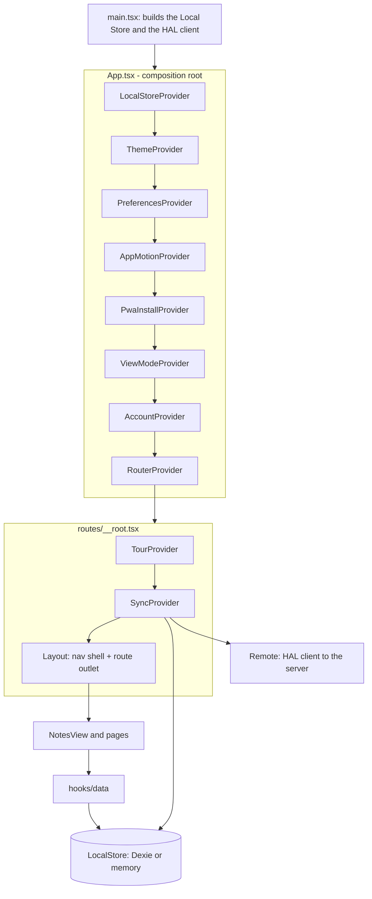
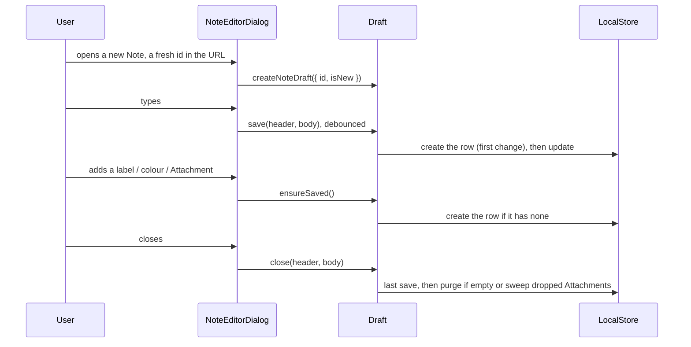

# CLAUDE.md

This file provides guidance to Claude Code (claude.ai/code) when working with code in this repository.

## Project

Open-source self-hosted PWA note-taking app (Google Keep alternative). Mobile-first React SPA with offline support via IndexedDB. Backend sync server is a separate repository - this repo is frontend-only.

## Hard rules

- Comments are for the human developer reading the code, never for agents.
  Agents get their context from the `.md` files (this file, `CONTEXT.md`, `DESIGN.md`, the ADRs, `docs/`), so a comment never briefs an agent.
- Code explains itself first: clean names and small functions say what the code does.
  A comment adds only what the code cannot say: why, a decision (link the ADR), a trap, or a constraint from outside the code.
- A comment is one to three lines.
  An explanation that needs more belongs in the area's `CLAUDE.md`, `CONTEXT.md` or an ADR, with a one-line pointer in the code.
- Never narrate the next line, never explain styling or layout (Tailwind classes), and write no comment where the code is already clear.
- Docs give a developer the high-level picture: what a part is for, the decision behind it and its traps.
  They do not walk the code line by line, and they never cite line numbers, which go stale; name the file or the function.

## Documentation map

- [`CONTEXT.md`](./CONTEXT.md) - domain glossary (canonical meaning of Note, Tag, Attachment, Sync, etc.).
- [`PLAN.md`](./PLAN.md) - overall roadmap and milestone order.
- [`PRODUCT.md`](./PRODUCT.md) - who the product is for, its positioning and operating context.
- [`DESIGN.md`](./DESIGN.md) - **the visual contract.** The `nightshift` direction ("Day desk, night shop"), its tokens, and its Named Rules, which are binding for any UI work. Written from measurement, not impression, so it also records six defects that must be fixed rather than ported.- [`docs/adr/`](./docs/adr/) - architecture decision records.
- [`docs/architecture/`](./docs/architecture/README.md) - the system described chapter by chapter (architecture, database, sync, server, testing).
- `docs/` is also the source of the VitePress site, published to GitHub Pages from `main` (`docs/.vitepress/config.ts`, `.github/workflows/pages.yml`); agent and thesis-only pages are kept off it by `srcExclude`.
  A page's links must resolve on the site and on GitHub alike, and the build fails on a dead one.
- Per-area docs (each folder's `CLAUDE.md` says how the area works):
  [`src/data`](./src/data/CLAUDE.md), [`src/hooks/data`](./src/hooks/data/CLAUDE.md), [`src/components/editor`](./src/components/editor/CLAUDE.md), [`src/context`](./src/context/CLAUDE.md).
- `docs/superpowers/` - agent plans, specs and slice records.
  Git-ignored, so it exists on the author's machine and not in a clone; nothing in the repository may link into it.

## Commands

Package manager is **pnpm**; never npm or yarn.

```bash
pnpm dev          # Vite dev server on :5173
pnpm build        # tsc + vite build
pnpm check        # Biome: lint, format, import sort (applies safe fixes)
pnpm check:ci     # Biome, non-mutating (the CI gate)
pnpm lint         # ESLint: only the React Hooks and typed rules Biome cannot express
pnpm test         # Vitest (unit, component, data)
pnpm test:e2e     # Playwright against `pnpm dev`, at a desktop and a mobile width
pnpm test:e2e:pwa # Playwright against the production build: service worker and offline
pnpm docs:dev     # the docs site; pnpm docs:build is what Pages runs
```

For the Account screens (Settings, `/pair`), run the backend's `pnpm dev` alongside, in the `ni-dip-be` repository checked out next to this one: Vite proxies `/api` and `/health` to port 3000.
The Pairing Link the backend prints points at port 3000, which serves no app in dev, so open its `/pair#<code>` on port 5173.
First Playwright run on a machine needs `pnpm exec playwright install chromium`.
Vitest sees `src/**` only and Playwright sees `e2e/` only.

## Architecture



What each provider does is in [`src/context/CLAUDE.md`](./src/context/CLAUDE.md).

### Data layer (`src/data/`, `src/hooks/data/`, `src/models.ts`)

All persistence goes through the `LocalStore` interface ([ADR 0020](./docs/adr/0020-the-local-store-seam.md)).
The default implementation is Dexie/IndexedDB, and Dexie is imported nowhere outside `src/data` (Biome enforces it).
Components read and write through the hooks in `src/hooks/data/`:

- `useNoteFeed` - the one feed query: lifecycle and tag scoping plus fuzzy ranked search.
- `useNoteActions`, `useTagActions`, `useAttachmentActions` - the mutations.
- `useTags`, `useTagsForNote`, `useNoteAttachments` - live reads.

State that lives in the URL, not in a context:

- **Search and filters** are typed TanStack search params (`q`, `sort`, `dir`, `tags`), validated by `src/lib/note-search-params.ts` and read through `useNoteSearchState()`.
- **The open Note** is the `note` param ([ADR 0014](./docs/adr/0014-the-open-note-lives-in-the-url.md), `useOpenNote()`), so the platform Back button closes the editor.
  A Note's id is minted when its editor opens, not on first save: the id is the dialog's React key, so swapping it mid-session would remount the editor under the user's cursor.

Two objects travel with an open Note:

- An **Intent** (`src/lib/intent.ts`) is the one-shot half of an open: begin recording, open the Drawing, insert chosen files, begin as a Checklist, play the first clip.
  `useOpenNote` keeps it in React state and spends it when the open ends, so a reload, Back or Forward never repeats it.
- A **Draft** (`src/lib/draft.ts`) is the Editor's working copy.
  `createNoteDraft` owns the Note's row: it is earned on the first real change or the first act that needs one (a label, a colour, an Attachment, a Reminder), through one write queue the autosave and every act share.
  Its `close` purges an empty Note or sweeps the Attachments the Body dropped.
  The dialog builds one Draft at mount and hands it to the note bar, labels, share, reminder and the Editor.



### Editor (`src/components/editor/`)

Built on **TipTap v3**; see [`src/components/editor/CLAUDE.md`](./src/components/editor/CLAUDE.md).
The short version:

- Every toolbar button is owned by its extension (Pattern A, [ADR 0004](./docs/adr/0004-canonical-editor-toolbar-pattern.md)): the upstream extension plus a `button` option, built by `withButton`.
- One-button marks and blocks are declarations in `extensions/formatting.ts`; anything with more (a node view, a plugin) gets a folder `extensions/<Name>/`.
- The toolbar is a registry of Toolbar Items the user can reorder and switch off ([ADR 0011](./docs/adr/0011-toolbar-items-and-families.md)).
- `icon` is a **string key** into `src/components/icons/icons.ts`; add new icons there.

### Routing (`src/routes/`)

**TanStack Router** with file-based routing ([ADR 0008](./docs/adr/0008-tanstack-router-over-react-router.md)).
`src/routeTree.gen.ts` is generated and committed: never edit it.
Route modules stay thin: they pick a scope and a title and delegate to `NotesView` or a page in `src/pages/`.

Routes: `/` (active feed), `/archive`, `/trash`, `/labels`, `/tag/$id`, `/settings`, `/pair` (where a Pairing Link lands; the code rides in the fragment) and `/share/$token` (a Share Link's read-only page).
The four feed routes share one `validateSearch`.

`/share/$token` is opened by strangers, so it renders bare: no shell, no Tour, no sync loop, an in-memory Local Store and no Account.
It writes nothing to the viewer's IndexedDB and never asks the server for a Session.

### Nav shell (`src/components/layout.tsx`, `src/components/nav/`)

The shell is the vendored shadcn `Sidebar` ([ADR 0010](./docs/adr/0010-shadcn-sidebar-as-nav-shell.md)): an icon-collapsible sidebar from `sm:` up, a left drawer below it.
`navItems.ts` is the single list of destinations, so the two cannot drift.
Settings is not a sidebar destination; the topbar gear is its one entry point.

**Quick capture** is one list of Starts (`notes/quickCaptureActions.ts`) rendered two ways: a `＋` speed dial on mobile (`QuickCaptureBar`) and inline icons on the desktop "Take a note" bar.
Their order and the dial's side are Preferences.
Each Start carries at most one Intent.
Image and Camera are picker Starts: `useStartPicker` opens the OS picker inside the tap itself, because the tap's user activation does not survive the route change to the editor.

**Insets.**
The four safe-area insets are named once in `globals.css` (`--safe-top` and friends) and are always added to the design's own spacing, never substituted for it.
They need `viewport-fit=cover` in `index.html`; to see a phone's insets on a desktop, override the four variables on `:root`.
The software keyboard is `--keyboard-inset`, published by `useKeyboardInset` from `window.visualViewport`, because iOS draws the keyboard over the page instead of resizing it.
It is a CSS variable rather than React state so the editor does not re-render on every frame of the keyboard's slide.
A view's floating action sits at the distance in `floatingBottomBar.ts`, shared with the speed dial because both land in that corner.

**Checklists on a Card** are ticked by tapping the box or the words (`lib/point-over-text.ts`); press-and-hold opens the Note (`lib/long-press.ts`).

**A11y.**
Every view renders an `<h1 tabIndex={-1}>` and focuses it on mount (`useFocusOnMount`), so a navigation moves focus to the destination heading.
In the feed views that heading is `sr-only`.

### Tags (`src/components/tags/`, `src/pages/labels.tsx`)

`NoteTagsBar` is the one place labels are assigned.
It is handed the editor's Draft and labels after `draft.ensureSaved()`, so a Draft earns its row on its first label.
`TagPills` renders a Note's labels read-only on the Card, tinted from the shared Note and Tag palette (`lib/note-colors.ts`).
`/labels` is the manage view: create, rename, colour, merge, delete.

### Reminders (`src/lib/reminder*.ts`, `src/lib/hand-off.ts`, `src/components/reminders/`)

A Reminder is two fields on the Note, `remindAt` and `repeat` ([ADR 0021](./docs/adr/0021-reminders-are-handed-off-to-the-calendar.md)).
**The app never notifies**: a web app without push cannot fire anything while closed, so the alarm belongs to the user's calendar.

- Setting a Reminder is handing it off.
  `useNoteReminder` earns the Draft's row, builds the `.ics` (`lib/reminder-ics.ts`), calls `handOff` (share where files can be shared, otherwise download), and only then writes the fields.
  A dismissed share sheet writes nothing, and the bell is lit after the write, not before: a lit bell over a failed write would promise an alarm nothing recorded.
- `remindAt` is a **local wall-clock string** (`YYYY-MM-DDTHH:mm`), the one exception to the ISO-timestamp rule, so 09:00 stays 09:00 across a DST change.
- `reminderOf` (`lib/reminder.ts`) is the one gate every reader goes through.
  It validates the fields (a backup's are unvalidated) and stops returning a one-shot more than 24h past.
  That lapse is a way of showing, never a write: no timer, and nothing bumps `updatedAt`.
- A past one-shot's chip is struck through, not faded, because fading fails contrast at the label's size; the past state is also in its accessible name.
- The popover's two actions are stacked, because side by side they are wider than the popover in Czech.

### Backup (`src/lib/backup.ts`, `src/components/settings/`)

The whole database exports to a `.zip`: a `manifest.json` plus one entry per Attachment blob.

- `parseBackupZip` is the only validation gate and never writes.
  Restore is replace-all, so an unreadable archive must be rejected while the user's data is still intact.
- `restoreBackup` wipes and rewrites in one transaction; the confirm dialog offers "save my current data first", checked by default.
- Saving asks for the destination **before** the bytes are built (`requestSaveTarget`), because the file picker needs the click's user activation.
  On the Firefox and Safari fallback it reports `confirmed: false`, and the UI must not claim the file landed.
- The three export buttons share `exportBackup(store, suffix)` (`lib/export-backup.ts`).
- Manifest rows are validated loosely, so unknown future fields survive a round trip.
- Preferences are not in a Backup; they are a Device fact.

### Theming (`src/styles/globals.css`, `src/context/`)

Colours are **OKLCH** custom properties in `globals.css`, the single token source for light and dark.
`ThemeProvider` is a custom provider (not `next-themes`): it persists the choice under its own `localStorage` key and toggles the `light`/`dark` class on `<html>`.

Preferences are read synchronously from `localStorage`, so the first render already has the user's choices.
Those the stylesheet has to act on are stamped onto `<html>` by `DocumentPreferences`: the `cvd` class, `data-density`, `data-reduced-motion` and `data-sink-checked`.
Every other Preference is read by the component that spends it.
A Settings row that shows and writes one Preference is a `PreferenceSwitch` or `PreferenceSegmented` bound to its key.

The 44px Touch Rule has two mechanisms that are not interchangeable: `.touch-target` grows a control to 44px (an icon button), `.touch-reach` gives it a 44px hit box and leaves its size alone (a switch, whose shape is part of what it says).

### The Tour (`src/lib/tour/`, `src/context/TourProvider.tsx`)

The six-step onboarding Tour ([ADR 0015](./docs/adr/0015-the-tour-drives-the-app-on-disposable-props.md)).
It **demonstrates**: every step drives the real app, and the user presses only Next, Back or Skip.

- **Props.**
  The Tour acts on three Notes it creates at the start and Purges at the end.
  `lib/tour/props.ts` holds the rules, and a bug there deletes something the user wrote.
  A Prop is purged only while its `updatedAt` still matches the baseline the Tour recorded, so every act that writes to a Prop rebases it; the `TourStage` a step receives offers only the rebasing writers.
  The baselines live in the Local Store's `meta`, written before the Prop rows, so a reload or a crash mid-Tour leaves something the next start can sweep.
- **Nothing in `src/lib/tour/` imports `driver.js` or React.**
  That is what makes the steps, targets, Prop rules and inert marking testable; `TourProvider` alone knows the spotlight library.
- **A step is a scene, not a layer.**
  Moving between steps is `exit` the one left, then `enter` the one arriving, in both directions, and `exit` is the strict inverse of `enter`.
  Steps 4-6 are one Settings scene looked at three times (`continues`).
- **The speed dial.**
  Step 1 opens it by clicking the `＋`.
  Whether it is open is read from whether its Starts are on screen, never from `aria-expanded`, which driver.js stamps onto whatever it highlights.
  Opening is awaited (driver measures the target once); closing is not, because step 2's editor covers the screen, and Back from step 2 closes the editor and awaits it.
- **Everything except the popover is `inert`** for the Tour's lifetime (`lib/tour/inert.ts`), kept as a standing rule by a `MutationObserver` because most of what must be marked mounts later.
  `inert` blocks hit testing, not dispatch, so a programmatic `.click()` still runs.
  An element that was already inert is never released.
- **Settings anchors** (`data-tour` wrappers) are declared in `src/pages/settings.tsx`, so no section knows the Tour exists.
  Toolbar and quick capture are two steps because nobody can scroll an inert app and together they do not fit a phone.
- **Targets** resolve to the first match with a non-zero rect (`lib/tour/targets.ts`), because several surfaces are mounted twice with CSS hiding one.
- **Waiting is on a DOM condition, never a timer** (`lib/tour/waitFor.ts`): `waitForTarget` for something to arrive on screen, `waitForGone` for something to leave it.
- `onboardingSeenAt` is stamped when the Tour is **offered**, not on completion, which would re-arm it after every reload.
- The Tour is verified by `e2e/onboarding.spec.ts` at two breakpoints, not by Vitest: jsdom measures every element as 0x0.

### i18n (`src/i18n.ts`)

**i18next** with browser language detection; translations are in `public/locales/<lng>/translation.json`, falling back to `en`.
Numbers and dates go through `src/lib/format.ts` with the app language passed in.
`src/i18n.test.ts` gates the bundles against each other: the same keys in every locale, and every key the Tour composes at render time.
The language is a Device fact like every Preference (not in a Backup, not synced), but i18next's detector keeps it in `localStorage` itself, not `PreferencesProvider`.
Settings uses a Select for it because the list outgrows a segmented control.

### Path alias

`@/` resolves to `src/`. Use it for all internal imports.

## Tooling & CI/CD

Decisions: [ADR 0005](./docs/adr/0005-biome-replaces-eslint-prettier.md) (Biome), [ADR 0006](./docs/adr/0006-ci-cd-and-container-image-distribution.md) (pipeline).

- **Biome** lints, formats and sorts imports (`biome.json`); it does not format Markdown or YAML.
  **ESLint** stays for the React Hooks and typed rules Biome cannot express, and nothing else.
- **Pre-commit** (husky + lint-staged) runs `biome check --write` and ESLint on staged files; safe fixes are applied, the rest block the commit.
- **Toolchain:** Node 24 (`.nvmrc`), pnpm through corepack.
- **GitLab pipeline** (`.gitlab-ci.yml`): `quality` (Biome, typecheck) → `test` (Vitest, Playwright) → `build` → `publish`.
  On the default branch and tags it builds the `Dockerfile` image, smoke-tests it and tags it `latest` or `vX.Y.Z`; the backend image builds FROM it.

## Development methodology: pragmatic TDD

Red → green → refactor, applied per layer ([ADR 0003](./docs/adr/0003-testing-stack-vitest-and-playwright.md)):

- **Test-first** for pure logic, the data layer, hooks and component behaviour; for a user flow, write the Playwright test before the feature.
- **Build-then-test** for purely visual layout; afterwards lock behaviour and accessibility (roles, labels, keyboard), not pixels.
- Every extension, data hook and user flow lands with its tests in the same change.
- Near-identical tests are one table-driven test.

## Key conventions

- **Style** ([ADR 0022](./docs/adr/0022-interfaces-and-closures-not-classes.md)): interfaces and closure factories, never classes.
- **Icons:** string keys in `src/components/icons/icons.ts`; never import Lucide icons into an extension's button config.
- **New TipTap extensions:** `withButton(Upstream, ctx => view)`; see the editor's `CLAUDE.md`.
- **DB schema changes:** increment the Dexie version in `src/data/dexie/db.ts` and add a migration if existing data must be preserved.
- **Dates:** ISO strings (`.toISOString()`); `remindAt` is the one exception.
- **Ids and timestamps:** ids are minted only by `mintId` in `src/lib/rows.ts`.
  Every Note, Tag, NoteTag and Attachment is born through one of its factories, which stamps both timestamps; a later write stamps `updatedAt` itself.
- **An effect that awaits:** `useAsyncEffect(effect, deps)` owns the cancel flag; the effect writes state only while `alive()` is true.
- **A user-started call that toasts its outcome:** `useAction()` gives `busy` and `run(act, { success, failure })`.
- **Tailwind v4:** CSS-based config in `globals.css`, no `tailwind.config.js`.
- **Files stay under 500 lines.**
- **Vendored and generated files are never edited:** `src/contract/index.ts` (refreshed by `pnpm contract:pull`, which copies it from the `ni-dip-be` repository checked out next to this one), `src/routeTree.gen.ts`.
