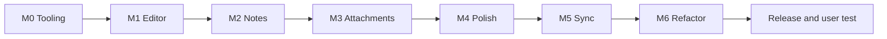

# PLAN - Overall roadmap

The roadmap for the frontend (React SPA + PWA).
The sync server lives in a separate repository, [`ni-dip-be`](https://gitlab.fit.cvut.cz/soukuj26/ni-dip-be); this repo plans only the client half of sync.

See [`CONTEXT.md`](./CONTEXT.md) for the glossary and [`docs/adr/`](./docs/adr/) for the decisions.

## Where we are

Milestones M0 to M6 are done.
The app is a local-first notes PWA with a rich editor, five kinds of Attachment, Tags, a Note lifecycle, Reminders, Backup, an onboarding Tour, and opt-in Sync with a Self-hosted Server, Share Links included.

## Next

1. **Release plumbing:** the CI image publish checked end to end, tag `v0.1.0`, and the setup guide reachable while signed out.
2. **User test** of the setup guide and the app, which the thesis brief requires.
3. **After the user test, re-grilled then:**
   - one shared set of sync algorithms for both Local Stores (read, decide, write), which fixes the Revision drift ticket below;
   - seam-level `SignedOut` and `Unreachable` on `Remote`, so `sync/loop.ts` stops importing the HTTP error;
   - the sync surface split off `LocalStore`;
   - theme, view mode and sidebar state folded into `PreferencesProvider`, with one provider stack shared with the test renderer.

Still open from earlier milestones: a high-contrast or low-vision palette, single-key power shortcuts with a `?` cheat sheet, keyboard shortcuts for the toolbar actions that have none, video poster and waveform extras, and **Import from other apps** ([ADR 0019](./docs/adr/0019-import-replaces-restore.md)).

Out of scope, deliberately: end-to-end encryption (the threat model is documented in ADR 0018 instead), sharing a Note between Accounts, and any email.

## Milestones

### M0 - Tooling & CI/CD ✅

Biome for lint and format ([ADR 0005](./docs/adr/0005-biome-replaces-eslint-prettier.md)), a pinned toolchain, and the GitLab pipeline that tests, builds and publishes the container image ([ADR 0006](./docs/adr/0006-ci-cd-and-container-image-distribution.md)).

### M1 - Test foundation + editor extensions ✅

Vitest and React Testing Library, and every editor extension on the one toolbar pattern ([ADR 0004](./docs/adr/0004-canonical-editor-toolbar-pattern.md)), each with a test.

### M2 and M2.5 - Notes ✅

The real notes home: the feed, the create bar and mobile quick capture, the editor dialog with autosave, delete with undo, and search.
Then the polish: the layout toggle, checklist capture, the mobile toolbar above the keyboard, and the "Saved" indicator.

### M3 - Attachments & rich media ✅

Images, audio (with recording), video, files and Excalidraw drawings, end to end on one shared attachment core.
Bytes are stored as Blobs ([ADR 0007](./docs/adr/0007-blob-over-base64-for-attachment-payloads.md)), the Body references them by id, and orphans are swept.

### M4 - Accessibility, polish & feature completion ✅

The last frontend-only milestone, in five slices:

1. **Foundations** - the Note lifecycle ([ADR 0009](./docs/adr/0009-note-lifecycle-model.md)), TanStack Router ([ADR 0008](./docs/adr/0008-tanstack-router-over-react-router.md)), Preferences, Tags, zip Backup.
2. **Search & capture** - fuzzy search, sort and filters in the URL, the speed dial; then the sidebar shell ([ADR 0010](./docs/adr/0010-shadcn-sidebar-as-nav-shell.md)).
3. **Polish sweep** - hover states, skeletons, semantics, the error boundary, more editor nodes and the slash menu.
4. **Identity & motion** - the `nightshift` design ([DESIGN.md](./DESIGN.md)), Motion, the customisable toolbar ([ADR 0011](./docs/adr/0011-toolbar-items-and-families.md)), checklist polish, full Settings.
5. **Onboarding** - the Tour ([ADR 0015](./docs/adr/0015-the-tour-drives-the-app-on-disposable-props.md)), which also brought Playwright.

### M5 - Sync ✅

The first milestone across both repositories.
Decisions: [ADR 0017](./docs/adr/0017-note-level-last-writer-wins-with-conflicted-copies.md) (Note-level last writer wins, with Conflicted Copies), [ADR 0018](./docs/adr/0018-the-server-serves-the-pwa.md) (the server serves the PWA) and [ADR 0020](./docs/adr/0020-the-local-store-seam.md) (the Local Store seam).
How it works is in [`docs/architecture/04-sync.md`](./docs/architecture/04-sync.md).

1. **The Local Store seam** - one interface every read and write goes through, with a Dexie and an in-memory implementation under one contract.
2. **Server skeleton** (backend) - Fastify, SQLite, HAL, Sessions, the Owner and Invites.
3. **Client foundations** - sync metadata in the store, the HAL client, the Account section and Pairing Links.
4. **The loop** - push with Revisions, pull by cursor, Conflicted Copies, adopt on first sign-in, erase on sign-out.
5. **Attachments** - idempotent byte transfer, eager thumbnails, full bytes on demand.
6. **Setup, docs, testing** - the setup guide is written (in the backend repo); the release and the user test are under Next.

Also shipped: **Share Links**, and the fixes from the backend rework's end-to-end run.

The client sync engine is tested against a fake server built from the vendored contract; real two-device testing is manual.

### M6 - Refactor: fewer copies, same style ✅

Six behaviour-preserving slices from four surveys of the code, in the codebase's interface-plus-closure style ([ADR 0022](./docs/adr/0022-interfaces-and-closures-not-classes.md)):

1. **Rows** - one module that mints ids and builds every row.
2. **Editor buttons** - `withButton`, and the simple extensions as declarations in one file.
3. **Attachments** - one descriptor table per kind, one insert path, one shared node view.
4. **UI helpers** - `useAsyncEffect`, `useAction`, shared Settings rows, the `Intent` type, locale-aware formatters.
5. **Draft** - `createNoteDraft` owns a Note's row for the life of one open.
6. **Tour trim** - the Tour's shared waits; no file is over 500 lines except one test (ticketed).

A bug a slice fixed by construction rode with it and got a pinning test; every other bug found became a ticket.

## Tickets

Found by the surveys and reviews, fixed by no slice.

- Dexie and memory stores drift: a Note added again under a purged, unpushed id pushes without its Revision in Dexie and with it in memory (`DexieLocalStore` add paths skip the Tombstone's `rev`). Not reachable from the UI today.
- `ThemeModeToggleButton` shows the sun while the theme is `system` over a dark OS.
- `EntityActionButtons` hardcodes English Save, Delete and Edit, and `EditButton` is unused; `ColorPickerPanel`'s "Custom" is untranslated.
- `/labels` create, merge and delete have no error path.
- Backups are named `ruflo-backup-...` while the app calls itself YourNotes.
- Four comments in `src/test/fakeServer.ts` and `fakeSync.ts` cite backend paths that no longer exist; `fakeSync.decide` is a hand copy of the backend's `decide.ts` that `contract:pull` could vendor.
- A cloned Attachment keeps its source's `thumbnailId`, so two rows name one server blob; this covers the editor's paste clone and the Conflicted Copy, and the impact depends on how the backend sweeps blobs.
- `notes.update` and `tags.update` take a change typed `Partial<T>`, which can return a new `id`; Dexie then writes a second row while memory keeps the old key.
  Type them `Partial<Omit<T, 'id'>>`.
- `AnyButtonView` checks nothing about props; making `AttachmentNodeConfig` generic over its component would let `createAttachmentNode` check `componentProps`.
- `withButton`'s `options: object` does not check upstream option names, so a misspelt `types` in TextAlign compiles; typing it as `Partial` of the upstream's options would close that.
- `toolbar/registry.ts` types every leaf as an `ActionButton` view though twelve yield another component; the only typed read is the optional `isActive`.
- Color, Highlight, FontFamily, FontSize and Mathematics are candidates for `withButton` (an overload for custom components, a factory for Mathematics), and the four near-identical text-style tests for one table.
- `SyncProvider.tsx` keeps three latest-value refs written in effects; candidates for `useLatest` once the effect timing is checked.
- `AudioRecorderHost` snapshots `getDeps()` at its own render; `useLatest(getDeps)` read as `deps()()` would read at use time if the host is ever memoised.
- `AttachmentNotDownloaded` renders a remote video as a plain `` with no marker that it is a video.
- `stripHtml` stops at the first `>` inside an attribute value and decodes only five entities; a DOM `textContent` projection would be exact.
- The toolbar picker's `onFiles` and the editor's paste and drop handlers have no test at any level; one table line calling `onFiles([file])` per picker kind and a Playwright paste or drop spec would pin them.
- A non-media file in a paste or drop is dropped silently (`TRANSFER_KINDS` has no `file`), while the toolbar's file picker takes any type; whether a drop should route non-media to `file` is a product decision.
- `dedupeForeignAttachments` (`attachments/insert.ts`, called `void` from the paste handler) awaits `getNoteId` and `cloneAttachment` with no catch, the same unhandled class `insertFiles` just closed.
- The drawing Save's error-code mapping in editor.tsx has no pinning test; the mocked Excalidraw dialog would need a throwing commit.
- Four ESLint warnings pre-exist in `LinkButton`, `themeProvider` and `use-mobile`; clearing them makes `pnpm lint` a zero-warning gate.
- `pnpm test:e2e` logs `ECONNREFUSED 127.0.0.1:3000` proxy errors from the Vite dev server when no backend runs; quiet the proxy in the Playwright web server or skip server calls when no backend is configured.
- `checklistItemIndexAt` (`lib/body.ts`, the card's tick-by-row helper) has no direct unit test; `e2e/checklist.spec.ts` is its only cover.
- `SyncStatusSection.useStorage` has no `catch`, so a rejected `navigator.storage.persisted()` is an unhandled rejection.
- `t` sits in the deps of the Devices, Members and Shares loads, so a language switch re-fetches each list; either drop `t` from those load deps (the app-side cause), or give the suite one shared `react-i18next` mock with a stable `t` (the test-side cause; 39 of the 40 test files that mock `react-i18next` build `t` inline today); the same per-render `t` is why `AccountSection.test.tsx` prints React `act()` warnings from DevicesSection and MembersSection under load (seen in one run of about ten).
- `LinkDialog.copy` and the clipboard: a rejected `writeText` is unhandled (the two copies it replaced were the same).
- On a browser without `showSaveFilePicker` (Firefox, Safari) the safety copy before an import is unconfirmed, yet the restore proceeds as if it were saved.
- `backupFilename` stamps UTC, not local time.
- The Radix empty-value guard (`(next as T) || value`) is repeated in `SortMenu` (twice) and `ToolbarLayoutEditor`.
- `index.html` keeps `lang="en"` under a Czech UI; nothing writes `document.documentElement.lang`.
- `useLive` could join `useAsyncEffect` in Biome's `useExhaustiveDependencies.options.hooks`, which would check its callers' deps too.
- `src/lib/saveTarget.test.ts` tests `requestSaveTarget` from `backup.ts`; the survey's "SaveTarget out of backup.ts" would give it a module.
- `PairingLinkButton`'s trigger has no `busy` guard, so a double tap mints two codes; the open dialog's overlay probably absorbs the second tap, unverified in a browser.
- `AccountProvider`'s context value writes `setSession` with the same two setters as `apply`; `setSession: apply` would make the three writers one.
- i18next typed resources: a Preference row's `keys` base, like every `t()` key, is a free string, so a typo compiles and renders the raw key; the identity-`t` tests catch five of the six rows, not `SyncStatusSection`'s; typed i18next resources would catch it at compile time.
- `useNoteFeed` sorts titles with `localeCompare(..., undefined, ...)`, so under a Czech UI on an English browser `Č` files beside `C` and `ch` sorts before `h`; it is the one locale-defaulting call left after slice 4.
- `ShareButton`'s load effect can, in principle, answer after `mint` on a Note's first share and turn the pressed mark off while the dialog shows the link (a GET outlasting a POST plus a sync); pre-existing, and since slice 5 the window also opens on a remount of a Draft that has its row.
- `NoteCard.test.tsx` (684 lines) is over the 500-line limit.
- `formatDate` throws on a malformed server date (`lastSeenAt`, `createdAt`, the sync time), as the module constants it replaced did; `reminderOf` guards the Reminder path, nothing guards these.
- `SyncStatusSection` has no component test; its keepEverything row and its storage line are exercised by no test in isolation.
- The app language is read two ways: `i18n.language` (`ReminderChip`, every `format.ts` caller) and `i18n.resolvedLanguage` (`LanguageSection`, the navbar); one accessor should win.
- Closing an untouched existing Note runs `updateNote` and bumps `updatedAt` (`notes.update` has no no-change short-circuit), so a read reorders a feed sorted by update and syncs as an edit; the dialog's `dirtyRef` already knows whether anything changed.
- A platform Back unmounts the editor without its close path, so the pending debounce window of typing is dropped, an emptied Note is not purged and orphan Attachments wait for the startup sweep (by reading, unverified in a browser).
- A failed autosave leaves the editor's status on "saving" with an unhandled rejection (no `catch` on the autosave's `.then` in `NoteEditorDialog`); the next write runs, but nothing tells the user.
- An `ensureSaved` that arrives after `close` purged the Note (a late Attachment insert) recreates the row from the last content, as `ensureNoteId` did.
- `NoteTagsBar` runs its live labels query on a Draft's own id from the start, and it settles after the dialog tests' last await, so `--reporter=verbose` shows one or two more React `act()` warnings than main's three; settling the store's live queries inside `act` in `renderWithStore` (`src/test/store.tsx`) would quiet every suite at once.
