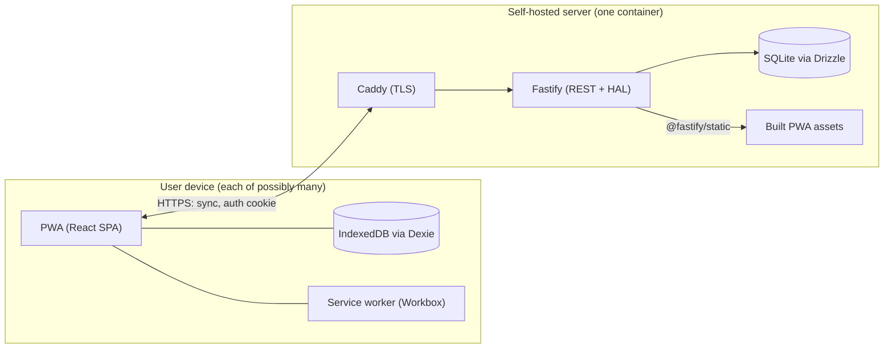
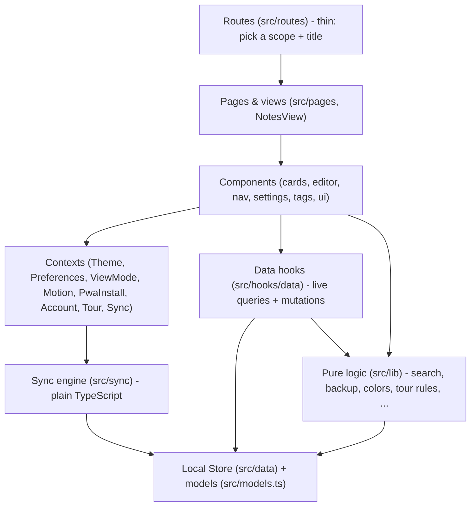

# Architecture

## System context

The product is **YouNotes**: a self-hosted, open-source, offline-first note-taking PWA - a Google Keep alternative the user runs on their own network.
It spans two repositories by decision ([ADR 0002](../adr/0002-separate-frontend-backend-repositories.md)):

- **`ni-dip-fe`** (this repo) - the React SPA/PWA. Fully functional with no server at all: all data lives in the browser's IndexedDB.
- **`ni-dip-be`** - the sync server (TypeScript + Fastify + SQLite). Its design is fixed by [ADR 0017](../adr/0017-note-level-last-writer-wins-with-conflicted-copies.md) and [ADR 0018](../adr/0018-the-server-serves-the-pwa.md). In production it *serves the built PWA* from its own origin, so a self-hoster runs one container.

The offline-first stance is architectural, not a feature: the network is the *addition*, IndexedDB is the source of truth on each device, and sync reconciles devices rather than serving reads ([ADR 0001](../adr/0001-local-first-storage-with-dexie.md)).

## Frontend layering

The SPA is layered strictly, with dependencies pointing downward only:

- **`src/data` + `src/models.ts`** - the persistence layer: the `LocalStore` interface, its Dexie and in-memory implementations, domain interfaces. See [03-database.md](./03-database.md).
- **`src/hooks/data`** - the only place components touch the Local Store. Live queries via `useLive` (`useTags`, `useNoteFeed`, `useTagsForNote`, `useNoteAttachments`) and mutation hooks (`useNoteActions`, `useTagActions`, attachment actions). A mutation is one atomic store method; the UI reacts through the live query, so there is no client-side cache to invalidate.
- **`src/lib`** - framework-free logic: fuzzy search (`note-search.ts`), URL param validation (`note-search-params.ts`), zip backup (`backup.ts`), color tokens (`note-colors.ts`), feed ranking (`feed-rank.ts`), the Tour's rules (`lib/tour/`, deliberately importing neither React nor driver.js). This layer is where most Vitest coverage lives.
- **Contexts** hold only what genuinely is app-global and not derivable: theme, preferences (persisted in `localStorage`), feed view mode, motion gating, PWA install prompt, the Account's Session, Tour state, and the sync loop.
- **`src/sync`** - the sync engine and its loop, plain TypeScript over the `LocalStore` and a `Remote`; `SyncProvider` only starts and stops it. See [04-sync.md](./04-sync.md).
- **Routes are thin.** TanStack Router file-based routes ([ADR 0008](../adr/0008-tanstack-router-over-react-router.md)) pick a Feed scope and delegate; `src/routeTree.gen.ts` is generated and committed.

`App.tsx` is the composition root: the Local Store, Theme, Preferences, Motion, PwaInstall, Tooltip, ViewMode and Account providers wrap `<RouterProvider>`; the Tour and Sync providers sit inside the router, in the root route.

## The state model: three homes, chosen by lifetime

State placement is a deliberate architectural rule rather than convention:

1. **The URL** holds everything that describes *what the user is looking at*: search query, sort, direction, tag filters, and which Note is open (`?note=`), as typed, validated search params ([ADR 0014](../adr/0014-the-open-note-lives-in-the-url.md)). Consequence: a searched feed is shareable and refresh-proof, and the platform back button closes the editor - critical in an installed PWA with no browser chrome.
2. **IndexedDB** holds everything the user *made*: Notes, Tags, Attachments. Preferences live in `localStorage` (`PreferencesProvider`) alongside other per-device UI state (theme choice, sidebar collapse).
3. **React state** holds only the ephemeral: the one-shot Intent of an open (start recording, autoplay a clip) that a reloaded URL must not re-fire, the Draft of the open Note, dialog/hover/drag state.

There is deliberately no global client-state store (no Redux/Zustand): live queries plus the URL cover what such a store usually holds.

## The editor as a plugin architecture

The TipTap-based Editor is itself a small architecture ([ADR 0004](../adr/0004-canonical-editor-toolbar-pattern.md), [ADR 0011](../adr/0011-toolbar-items-and-families.md)):

- Each capability is an **Extension**, contributing behavior *and* its own Toolbar Button factory - the toolbar is assembled from what the extensions declare, not from a central list.
- Attachments (image, audio, video, file, Excalidraw drawing) are custom TipTap nodes built on one shared `attachments/` core. The Body HTML stores only `data-attachment-id` references; bytes live in the `attachments` table ([ADR 0007](../adr/0007-blob-over-base64-for-attachment-payloads.md)).
- The toolbar is user-customisable per Width Class (Compact/Wide), stored as a preference; Width Class decides layout, Pointer Class decides affordances ([ADR 0016](../adr/0016-width-decides-layout-pointer-decides-affordances.md)).

## PWA shell

- `vite-plugin-pwa` (Workbox) precaches the built app; `registerType: 'prompt'` gives an explicit in-app update flow rather than a silent swap.
- Installability, service worker, `navigator.storage.persist()` and media capture all require a secure context - the fact that forces the "server serves the PWA + Caddy TLS" decision ([05-server.md](./05-server.md)).
- Persistent storage is requested on the user's first *saved* note (`src/lib/persistentStorage.ts`), not at startup, so the Firefox permission prompt cannot interrupt the onboarding Tour.
- Safe-area insets (`viewport-fit=cover`, `--safe-top/right/bottom/left`) are always *added to* design spacing, never substituted for it.

## Cross-cutting concerns

- **Theming**: OKLCH design tokens in `src/styles/globals.css`; a custom `ThemeProvider` toggles the `light`/`dark` class; colors are stored as palette *tokens*, never raw values, so the colour-blind Vision Mode can re-value them.
- **Accessibility**: 44px touch-target rules, focus moved to the destination `<h1>` on navigation, `inert`-based focus trapping in the Tour, reduced-motion as a hard gate on every animation.
- **i18n**: i18next, `en`/`cs` with `en` fallback; a test gates the two bundles against key drift.
- **Error handling**: a top-level `ErrorBoundary`; validation at boundaries (URL params via the router's `validateSearch`, backup import via `parseBackupZip`, and every server response via Zod).

## For the paper

- The strongest architectural claims to defend: local-first as the default (not a degraded mode), the three-homes state model, the URL as the application state, and the extension/plugin editor.
- The layering diagram above maps 1:1 to `src/` folders, which makes it verifiable rather than aspirational.
- Quality attributes served: offline availability, privacy (no runtime external requests at all - no CDN, no analytics), installability, accessibility, and modifiability (tokens, extensions, per-area plans).
