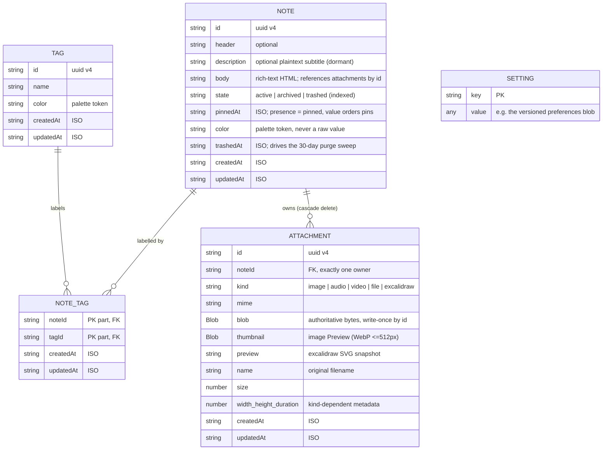

# Database and schema

All persistence is IndexedDB, accessed through **Dexie** (`src/data/dexie/db.ts`); domain models live in `src/models.ts`.
The app reaches it only through the `LocalStore` interface ([ADR 0020](../adr/0020-the-local-store-seam.md)): Dexie is the default implementation, an in-memory one ships beside it, and one contract test suite runs against both.
IndexedDB was chosen over alternatives for real Blob storage, transactions, indexes, and the storage quota a notes app with media needs ([ADR 0001](../adr/0001-local-first-storage-with-dexie.md)); attachment bytes are stored as native `Blob`s, not base64 ([ADR 0007](../adr/0007-blob-over-base64-for-attachment-payloads.md)).

The schema itself is unchanged by ADR 0020 - the app no longer touches it directly.
Two `LocalStore` implementations exist: Dexie (below) and an in-memory one (`src/data/memory/`).
Preferences left the `settings` table for `localStorage`; what remains there is bookkeeping under `meta` (the Tour's Prop baselines today).

## Entity model

Conventions: every id is uuid v4; every timestamp is an ISO string (`.toISOString()`).

Design points worth defending in the paper:

- **The Body is the aggregate's spine.** Attachments and Checklists live *inside* the HTML Body as references (`data-attachment-id`), not beside it as sibling collections. The `attachments` table owns the bytes; the Body decides which are shown and where. This single fact later dictates the sync conflict model (see [04-sync.md](./04-sync.md)).
- **One generic `attachments` table** with a `kind` discriminator replaced planned per-type tables (v2). Every media slice since has reused the same storage, actions and GC.
- **`NoteTag` is a real join table** (composite primary key `[noteId+tagId]`), because a Tag has independent life. In M5 the link is its own synced row precisely so labelling never conflicts with writing.
- **`settings` is a key-value store** whose values version themselves (the preferences blob carries its own schema version), so adding a preference never costs a Dexie bump.
- **Orphans are swept, not chased.** Removing an attachment reference does not delete bytes immediately (in-editor undo may bring it back); a reconciliation sweep at editor close and app start reclaims unreferenced rows. Purge (trash grace elapsed, or Tour Props) uses the same sweep machinery.

One denormalization exists: `Note.tags?: Tag[]` is an optional preloaded override consumed by `NoteCard` (which falls back to the live `useTagsForNote` query when absent). The join table remains the source of truth.

## Schema versions

Dexie strings declare *indexes*, not columns - non-indexed fields are free, which shapes when a version bump is needed at all.

| Version | Change | Migration |
|---|---|---|
| v1 | `notes`, per-type `images`/`audios`/`files`, `tags`, `noteTags` | - |
| v2 | Fold the never-populated per-type media tables into one `attachments` (`id, noteId, kind`) | None needed (stores were never written) |
| v3 | Note lifecycle ([ADR 0009](../adr/0009-note-lifecycle-model.md)): index `state`, `pinnedAt`, `trashedAt`; retire the dead `checklist` field | **`.upgrade()` required**: `state` is indexed and IndexedDB omits rows whose indexed property is `undefined` - without stamping `state: 'active'` on existing rows, every pre-v3 note would silently vanish from `where('state')` queries |
| v4 | `settings` key-value store | None |

The v3 lesson generalizes and is the repo's canonical migration rule: adding an *optional, non-indexed* field is free; adding an *indexed* field requires backfilling every existing row or those rows become invisible to queries on it.

## Planned v5: sync metadata (M5 slice 3)

Shape fixed by [ADR 0017](../adr/0017-note-level-last-writer-wins-with-conflicted-copies.md); detail in [`src/data/PLAN.md`](../../src/data/PLAN.md).

- **`rev` + an indexed dirty marker** on `notes`, `tags`, `noteTags`. `rev` is the server Revision the row last agreed with; absent means never pushed - which is exactly what a pre-sync database is, so no backfill is needed.
- **The Offline Mutation Queue is a query, not a table**: `where('dirty')`. There is deliberately no queue store - it would be a second source of truth a crash could leave disagreeing with the rows themselves.
- **A `tombstones` store** (`id`, entity kind, `deletedAt`), written only by a Purge; trashing is a `state` update and syncs as an ordinary edit.
- **Attachments carry no `rev`.** Metadata rides on the owning Note's Revision; bytes are write-once by id, so their only sync state is "are the bytes present locally" (previews sync eagerly, full bytes on demand).
- **Cursor and account identity live in `meta`** (the `settings` table, which Preferences leave for `localStorage` in slice 1): the opaque `_links.next` URL, `lastSyncedAt`, and the attached Account id (what makes erase-on-sign-out enforceable).
- Prerequisite refactor: the Excalidraw save path must mint a *new* attachment id and repoint the Body, making every blob immutable by id.

## Testing the layer

Data-layer tests run in Vitest against `fake-indexeddb`, including a dedicated migration test (`lifecycle.migration.test.ts`) and a Blob round-trip test that must run in the `node` environment (jsdom reads a stored Blob back as a plain object).
The `NotesDB` constructor takes a database name only so migration tests can spin up throwaway instances; the app uses one singleton.

## For the paper

- The schema is small by design: five stores, one join table, one KV store. The interesting content is the *rules around it* - Body-as-spine, write-once blobs, sweep-based GC, queue-as-query - each of which removes a class of consistency bug rather than handling it.
- The v3 migration is a concrete, honest war story about IndexedDB semantics.
- The absence of both a queue table and merge metadata (no per-field timestamps, no operation log) is the measurable payoff of the ADR 0017 conflict model.
