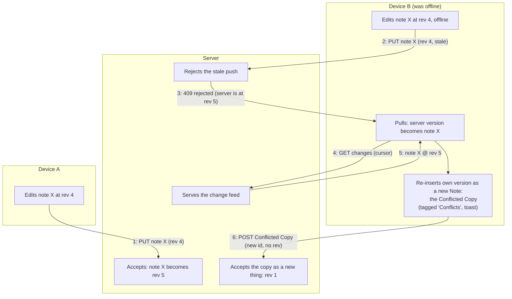

# Sync

The M5 synchronization design.
Decided 2026-08-12; the conflict model is [ADR 0017](../adr/0017-note-level-last-writer-wins-with-conflicted-copies.md), the deployment/auth frame is [ADR 0018](../adr/0018-the-server-serves-the-pwa.md) ([05-server.md](./05-server.md)).
Glossary terms (Revision, Conflicted Copy, Tombstone, Offline Mutation Queue) are canonical in [`CONTEXT.md`](../../CONTEXT.md).

## The problem

Two devices can edit the same Note while one is offline.
The Body is the thing actually fought over: it is one HTML string, and every richer element (attachments, checklists) lives inside it.
So any strategy that merges `header`, `color` and `state` field-by-field has not touched the real conflict.

## The model: note-level last-writer-wins, losers kept

**The server holds a Revision per synced thing.
A push carrying a stale Revision is rejected; the server's version becomes the Note, and the device's version is kept beside it as an ordinary Note - a Conflicted Copy.**

Sync never discards anything a user wrote.
Resolving a conflict is a person reading two Notes and deleting one - never something the app does silently.
A Conflicted Copy is surfaced, not hidden: it gets a "Conflicts" Tag and a header naming its origin device and date, which makes the existing `/tag/$id` screen the review surface at no extra cost.
The honest cost of the model: concurrent edits to one Note lose no text but produce a duplicate - a failure mode a user can understand and repair.

### Revision boundaries

| Synced thing | Own Revision? | Why |
|---|---|---|
| Note (incl. its attachment *metadata*) | Yes | The aggregate; an Attachment belongs to exactly one Note and has no independent life |
| Tag | Yes | Independent life by definition |
| NoteTag link | Yes | Deliberately bought granularity: typing into a note on the laptop while tapping "+ Label" on the phone must not produce a duplicate card - labelling must never conflict with writing |
| Attachment bytes | No | Write-once by id (the one rewriter, Excalidraw save, is refactored to mint a new id), so transfer is an idempotent `PUT` with no conflict rule possible |

### Deletions: Tombstones

Trashing is a `state` field update ([ADR 0009](../adr/0009-note-lifecycle-model.md)) and syncs as an ordinary edit, undo window included.
A Tombstone is written only by a Purge, so genuine deletions are rare and mostly machine-generated.
Tombstones expire on the server after 90 days; a device whose cursor predates that window is told so and performs a full resync - discarding its clean rows, keeping its dirty ones.

## The Offline Mutation Queue is a set, not a log

What the server is owed is the *current state* of each changed thing, not the history of how it got there: ten offline edits to one Note owe one push.
Implementation follows: every mutation marks its row dirty inside the transaction that already writes it, and "the Queue" is `where('dirty')` - a way of reading the data, not a second store that could disagree with it.
This replaced an earlier plan for an ordered intent log, which was both more work and less robust (a crash can leave a log disagreeing with the rows).

## The loop

The client sync engine runs in a `SyncProvider` on the main thread, sharing the app's Dexie connection (ceiling: move to a Worker if a large first pull janks the UI).
Change detection is polling on focus / `online` / visibility, plus a short interval while visible; an SSE hint channel ("the server is at Revision N" - never data, never load-bearing) is a named follow-up, not a dependency.

Pull side: the change feed is a HAL collection; the device stores the opaque `_links.next` URL as its cursor and never constructs a query string.
Completed change pages are immutable, so `ETag` caching is safe and cheap.
The Conflicted Copy arrives through `createNote` + `addTagToNote` - existing, already-tested machinery; the sync engine owns conflict handling, components never do.

## Attachment transfer

- Bytes are immutable by id, so upload is "PUT if the server lacks this id" - idempotent, retryable, no conflict rule.
- **Previews sync eagerly** (tens of KB; the Feed is instantly correct on a new device); **full bytes on demand**, with a "keep everything on this device" preference.
- Attachment node views gain a third state, "known but not downloaded", rendering a placeholder instead of a broken element.
- Known ceilings, accepted: no resumable upload, no per-account quota.

## Account boundary interactions

- **Adopt on first sign-in**: a never-attached database bulk-marks every row dirty and pushes it (UUIDs cannot collide).
- **Erase on sign-out**: full local wipe (the server holds everything; prevents the next user of a shared laptop adopting someone else's Notes), blocked while anything is dirty and offering the zip backup first.
- Per-entity sync state (dirty / synced / conflicted) is exposed through the data hooks; the editor's "Saved" keeps meaning *saved locally*, shown separately, so the local-first guarantee is never conflated with sync.

## Alternatives rejected (thesis material)

- **Field-level merge**: resolves the cheap fields and leaves the Body - the actual collision - on LWW anyway; per-field timestamps on every row is a poor trade for that.
- **CRDT (Yjs) for the Body**: the technically superior merge, rejected with reasons recorded. It would make the Yjs document the real Note and the HTML a derived cache (breaking the invariant relied on by card previews, search, backup and attachment references), wants a WebSocket rather than the brief's REST commitment, and would be the largest single item in M5, competing with the milestone's actual goal (sync an average person can set up). It remains open as a later Body-only upgrade inside the same Revision framework.

## Testing strategy

The client engine is tested in this repo against a fake server built from the vendored Zod contract, so conflict, resync and offline paths are deterministic.
The backend tests itself in its own repo; genuine two-device end-to-end is a manual and user-testing activity (a cross-repo Playwright pipeline would cost more than it catches).

## For the paper

- Frame the design as choosing a *failure mode*, not an algorithm: LWW-with-conflicted-copies trades automatic merging for zero silent data loss and a repair action a non-technical user can perform.
- The Revision-boundary table is the core analytical contribution: each row is an aggregate-design argument.
- The rejected-CRDT section writes itself into a related-work/alternatives chapter; the honest recording of why the superior merge lost is exactly what an architecture paper wants.
