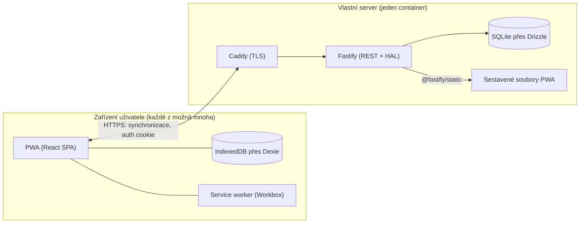
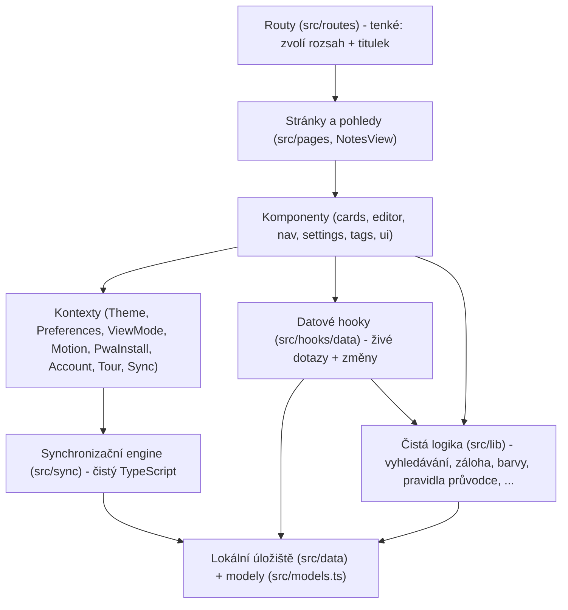

# Architektura

## Kontext systému

Produktem je **YourNotes**: self-hosted, open-source, offline-first PWA pro psaní poznámek - alternativa ke Google Keep, kterou si uživatel provozuje ve vlastní síti.
Podle rozhodnutí se rozkládá do dvou repozitářů ([ADR 0002](../adr/0002-separate-frontend-backend-repositories.md)):

- **`ni-dip-fe`** (toto repo) - React SPA/PWA. Plně funkční zcela bez serveru: všechna data žijí v IndexedDB prohlížeče.
- **`ni-dip-be`** - synchronizační server (TypeScript + Fastify + SQLite). Jeho návrh určují [ADR 0017](../adr/0017-note-level-last-writer-wins-with-conflicted-copies.md) a [ADR 0018](../adr/0018-the-server-serves-the-pwa.md). V produkci *servíruje sestavenou PWA* ze svého vlastního originu, takže kdo si aplikaci hostuje sám, provozuje jeden container.

Přístup offline-first je architektonický, ne funkce: síť je *doplněk*, IndexedDB je zdrojem pravdy v každém zařízení a synchronizace sladí zařízení mezi sebou, místo aby obsluhovala čtení ([ADR 0001](../adr/0001-local-first-storage-with-dexie.md)).

## Vrstvy frontendu

SPA je striktně vrstvená a závislosti směřují pouze dolů:

- **`src/data` + `src/models.ts`** - perzistentní vrstva: rozhraní `LocalStore`, jeho implementace nad Dexie a v paměti, doménová rozhraní. Viz [03-database.md](./03-database.md).
- **`src/hooks/data`** - jediné místo, kde se komponenty dotýkají lokálního úložiště. Živé dotazy přes `useLive` (`useTags`, `useNoteFeed`, `useTagsForNote`, `useNoteAttachments`) a hooky pro změny (`useNoteActions`, `useTagActions`, akce příloh). Změna je jedna atomická metoda úložiště; UI reaguje přes živý dotaz, takže neexistuje žádná klientská cache, kterou by bylo třeba invalidovat.
- **`src/lib`** - logika bez frameworku: fuzzy vyhledávání (`note-search.ts`), validace parametrů URL (`note-search-params.ts`), záloha do zipu (`backup.ts`), barevné tokeny (`note-colors.ts`), pořadí v přehledu (`feed-rank.ts`), pravidla průvodce (`lib/tour/`, záměrně neimportuje React ani driver.js). V této vrstvě žije většina pokrytí testy Vitest.
- **Kontexty** drží jen to, co je skutečně globální pro aplikaci a nedá se odvodit: motiv, předvolby (perzistované v `localStorage`), režim zobrazení přehledu, řízení animací, výzvu k instalaci PWA, relaci účtu, stav průvodce a synchronizační smyčku.
- **`src/sync`** - synchronizační engine a jeho smyčka, čistý TypeScript nad `LocalStore` a `Remote`; `SyncProvider` ho jen spouští a zastavuje. Viz [04-sync.md](./04-sync.md).
- **Routy jsou tenké.** Souborové routy TanStack Router ([ADR 0008](../adr/0008-tanstack-router-over-react-router.md)) zvolí rozsah přehledu a předají řízení dál; `src/routeTree.gen.ts` je generovaný a commitnutý.

`App.tsx` je kořen kompozice: providery Local Store, Theme, Preferences, Motion, PwaInstall, Tooltip, ViewMode a Account obalují `<RouterProvider>`; providery Tour a Sync sedí uvnitř routeru, v kořenové routě.

## Model stavu: tři domovy, zvolené podle životnosti

Umístění stavu je záměrné architektonické pravidlo, ne konvence:

1. **URL** drží vše, co popisuje, *na co se uživatel dívá*: vyhledávací dotaz, řazení, směr, filtry štítků a která poznámka je otevřená (`?note=`), jako typované, validované search parametry ([ADR 0014](../adr/0014-the-open-note-lives-in-the-url.md)). Důsledek: přehled s vyhledáváním lze sdílet a přežije obnovení stránky a systémové tlačítko Zpět zavře editor - zásadní v nainstalované PWA bez ovládacích prvků prohlížeče.
2. **IndexedDB** drží vše, co uživatel *vytvořil*: poznámky, štítky, přílohy. Předvolby žijí v `localStorage` (`PreferencesProvider`) spolu s dalším stavem UI vázaným na zařízení (volba motivu, sbalení postranního panelu).
3. **Stav Reactu** drží jen pomíjivé věci: jednorázový záměr (Intent) otevření (spustit nahrávání, automaticky přehrát klip), který znovu načtená URL nesmí spustit podruhé, koncept otevřené poznámky, stav dialogů, najetí myší a přetahování.

Záměrně neexistuje žádné globální úložiště klientského stavu (žádný Redux/Zustand): živé dotazy spolu s URL pokrývají to, co takové úložiště obvykle drží.

## Editor jako architektura pluginů

Editor postavený na TipTapu je sám malou architekturou ([ADR 0004](../adr/0004-canonical-editor-toolbar-pattern.md), [ADR 0011](../adr/0011-toolbar-items-and-families.md)):

- Každá schopnost je **rozšíření**, které přispívá chováním *i* vlastní továrnou na tlačítko panelu nástrojů - panel nástrojů se skládá z toho, co rozšíření deklarují, ne z centrálního seznamu.
- Přílohy (obrázek, zvuk, video, soubor, kresba v Excalidraw) jsou vlastní uzly TipTapu postavené na jednom sdíleném jádru `attachments/`. HTML těla poznámky ukládá jen odkazy `data-attachment-id`; bajty žijí v tabulce `attachments` ([ADR 0007](../adr/0007-blob-over-base64-for-attachment-payloads.md)).
- Panel nástrojů si uživatel může přizpůsobit pro každou šířkovou třídu (úzkou/širokou) a ukládá se jako předvolba; šířková třída rozhoduje o rozvržení, typ ukazatele o ovládacích prvcích ([ADR 0016](../adr/0016-width-decides-layout-pointer-decides-affordances.md)).

## PWA shell

- `vite-plugin-pwa` (Workbox) předem ukládá do cache sestavenou aplikaci; `registerType: 'prompt'` dává explicitní postup aktualizace v aplikaci místo tiché výměny.
- Instalovatelnost, service worker, `navigator.storage.persist()` i záznam médií vyžadují zabezpečený kontext - právě to si vynutilo rozhodnutí „server servíruje PWA + Caddy TLS“ ([05-server.md](./05-server.md)).
- O trvalé úložiště se žádá při první *uložené* poznámce uživatele (`src/lib/persistentStorage.ts`), ne při startu, aby výzva Firefoxu k oprávnění nemohla přerušit úvodního průvodce.
- Safe-area insety (`viewport-fit=cover`, `--safe-top/right/bottom/left`) se vždy *přičítají* k odsazení z návrhu, nikdy ho nenahrazují.

## Průřezové záležitosti

- **Motivy**: designové tokeny OKLCH v `src/styles/globals.css`; vlastní `ThemeProvider` přepíná třídu `light`/`dark`; barvy se ukládají jako *tokeny* palety, nikdy jako surové hodnoty, takže režim pro barvoslepé je může přemapovat.
- **Přístupnost**: pravidla pro 44px dotykové cíle, přesun fokusu na cílový `<h1>` při navigaci, uzamčení fokusu v průvodci pomocí `inert`, omezení pohybu jako tvrdá podmínka každé animace.
- **i18n**: i18next, `en`/`cs` se záložním jazykem `en`; test hlídá, aby se klíče obou balíčků nerozešly.
- **Zpracování chyb**: `ErrorBoundary` na nejvyšší úrovni; validace na hranicích (parametry URL přes `validateSearch` routeru, import zálohy přes `parseBackupZip` a každá odpověď serveru přes Zod).

## Pro text práce

- Nejsilnější architektonická tvrzení k obhajobě: local-first jako výchozí stav (ne degradovaný režim), model stavu se třemi domovy, URL jako stav aplikace a editor postavený na rozšířeních a pluginech.
- Diagram vrstev výše odpovídá 1:1 složkám v `src/`, takže je ověřitelný, ne jen proklamovaný.
- Podporované atributy kvality: dostupnost offline, soukromí (vůbec žádné externí požadavky za běhu - žádné CDN, žádná analytika), instalovatelnost, přístupnost a modifikovatelnost (tokeny, rozšíření, plány pro jednotlivé oblasti).
