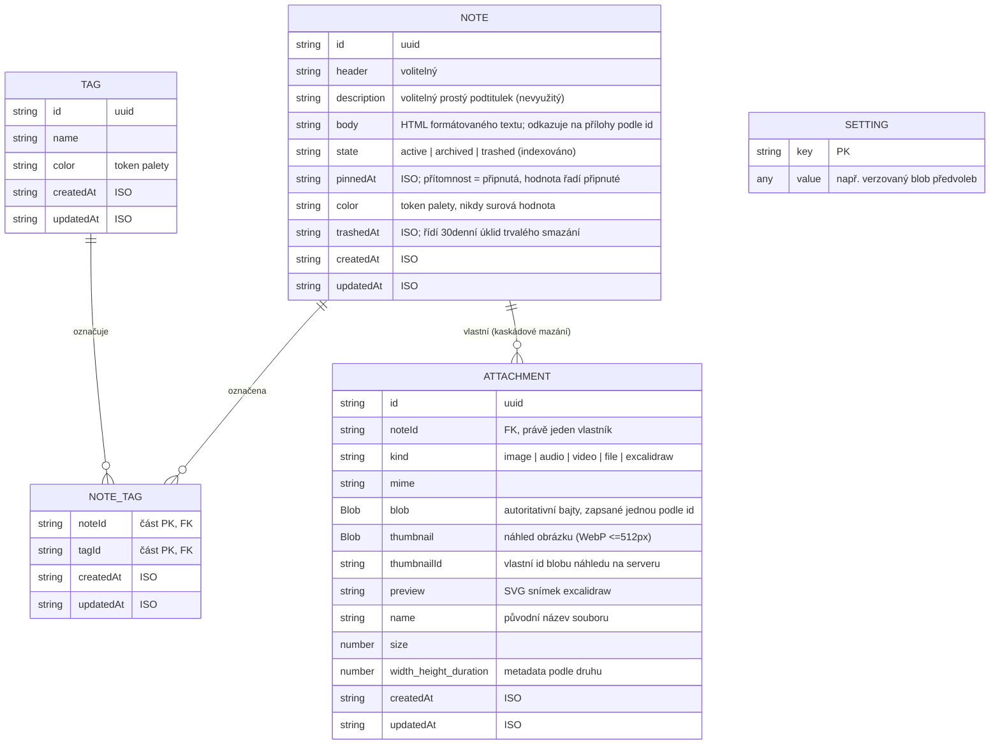

# Databáze a schéma

Veškerá perzistence je v IndexedDB, přístupná přes **Dexie** (`src/data/dexie/db.ts`); doménové modely jsou v `src/models.ts`.
Aplikace k ní přistupuje jen přes rozhraní `LocalStore` ([ADR 0020](../adr/0020-the-local-store-seam.md)): Dexie je výchozí implementace, vedle ní je k dispozici implementace v paměti a proti oběma běží jedna sada kontraktových testů.
IndexedDB byla zvolena před alternativami kvůli skutečnému ukládání blobů, transakcím, indexům a kvótě úložiště, kterou aplikace na poznámky s médii potřebuje ([ADR 0001](../adr/0001-local-first-storage-with-dexie.md)); bajty příloh se ukládají jako nativní `Blob`y, ne jako base64 ([ADR 0007](../adr/0007-blob-over-base64-for-attachment-payloads.md)).

Samotné schéma ADR 0020 nezměnilo - aplikace se ho jen už přímo nedotýká.
Existují dvě implementace `LocalStore`: Dexie (níže) a implementace v paměti (`src/data/memory/`).
Předvolby se z tabulky `settings` přesunuly do `localStorage`; zbývá v ní evidence pod `meta` (dnes výchozí stavy rekvizit průvodce).

## Entitní model

Konvence: každé id je UUID vytvořené funkcí `mintId` (`src/lib/rows.ts`); každé časové razítko je řetězec ISO, s výjimkou `remindAt` u připomenutí, což je řetězec místního času ([ADR 0021](../adr/0021-reminders-are-handed-off-to-the-calendar.md)).
Synchronizované řádky nesou také stav synchronizace soukromý pro úložiště (níže) a úložiště `tombstones` eviduje trvalá smazání, která server ještě musí dostat.

Body návrhu, které stojí za obhajobu v textu práce:

- **Tělo poznámky je páteří agregátu.** Přílohy a seznamy úkolů žijí *uvnitř* HTML těla poznámky jako odkazy (`data-attachment-id`), ne vedle něj jako sourozenecké kolekce. Tabulka `attachments` vlastní bajty; tělo poznámky rozhoduje, které se zobrazí a kde. Právě tento jediný fakt později určuje model konfliktů při synchronizaci (viz [04-sync.md](./04-sync.md)).
- **Jedna obecná tabulka `attachments`** s diskriminátorem `kind` nahradila plánované tabulky podle typu (v2). Každý další mediální slice od té doby využívá stejné úložiště, akce i GC.
- **`NoteTag` je skutečná spojovací tabulka** (složený primární klíč `[noteId+tagId]`), protože štítek má nezávislý život. Vazba je vlastním synchronizovaným řádkem právě proto, aby označování štítkem nikdy nekolidovalo s psaním.
- **`settings` je úložiště klíč-hodnota**, vystavené jako `meta` lokálního úložiště; drží výchozí stavy rekvizit průvodce a evidenci synchronizace (kurzor a připojený účet) a hodnoty se tam, kde je to potřeba, stále verzují samy.
- **Osiřelé přílohy se uklízejí, nehoní se.** Odebrání odkazu na přílohu bajty hned nesmaže (vrácení zpět v editoru je může obnovit); úklidová rekonciliace při zavření editoru a při startu aplikace uvolní neodkazované řádky. Trvalé smazání (uplynutí lhůty v koši nebo rekvizity průvodce) používá stejný úklidový mechanismus.

Existuje jedna denormalizace: `Note.tags?: Tag[]` je volitelné předem načtené přepsání, které využívá `NoteCard` (bez něj se vrací k živému dotazu `useTagsForNote`). Zdrojem pravdy zůstává spojovací tabulka.

## Verze schématu

Řetězce Dexie deklarují *indexy*, ne sloupce - neindexovaná pole jsou zdarma, a to určuje, kdy je navýšení verze vůbec potřeba.

| Verze | Změna | Migrace |
|---|---|---|
| v1 | `notes`, tabulky podle typu `images`/`audios`/`files`, `tags`, `noteTags` | - |
| v2 | Sloučení nikdy nenaplněných mediálních tabulek podle typu do jedné `attachments` (`id, noteId, kind`) | Není potřeba (do úložišť se nikdy nezapisovalo) |
| v3 | Životní cyklus poznámky ([ADR 0009](../adr/0009-note-lifecycle-model.md)): indexy `state`, `pinnedAt`, `trashedAt`; vyřazení mrtvého pole `checklist` | **Nutný `.upgrade()`**: `state` je indexované a IndexedDB vynechává řádky, jejichž indexovaná vlastnost je `undefined` - bez doplnění `state: 'active'` do existujících řádků by každá poznámka z doby před v3 tiše zmizela z dotazů `where('state')` |
| v4 | Úložiště klíč-hodnota `settings` | Žádná |
| v5 | Metadata synchronizace: indexovaný příznak změny na `notes`, `tags`, `noteTags`; úložiště `tombstones` | Žádná: chybějící `rev` správně znamená „nikdy neodesláno“ |

Ponaučení z v3 platí obecně a je kanonickým pravidlem migrací v repozitáři: přidání *volitelného, neindexovaného* pole je zdarma; přidání *indexovaného* pole vyžaduje doplnění hodnoty do každého existujícího řádku, jinak se tyto řádky stanou pro dotazy na něj neviditelnými.

## Metadata synchronizace (v5)

Tvar stanovuje [ADR 0017](../adr/0017-note-level-last-writer-wins-with-conflicted-copies.md); pravidla jsou v [`src/data/CLAUDE.md`](https://github.com/soukupj00/your-notes-fe/blob/main/src/data/CLAUDE.md).

- **`rev` + indexovaný příznak změny** na `notes`, `tags`, `noteTags`. `rev` je serverová revize, se kterou se řádek naposledy shodoval; chybějící hodnota znamená, že řádek nebyl nikdy odeslán - což přesně odpovídá databázi z doby před synchronizací, takže nebylo potřeba nic doplňovat.
  Obojí je soukromé pro úložiště: žádné čtení je nevrací, takže žádný volající nemůže do zápisu zanést zastaralou revizi.
- **Fronta offline změn je dotaz, ne tabulka**: řádky s příznakem změny. Úložiště fronty záměrně neexistuje - byl by to druhý zdroj pravdy, který by po pádu mohl zůstat v rozporu se samotnými řádky.
- **Úložiště `tombstones`**, do kterého zapisuje jen trvalé smazání; přesun do koše je aktualizace `state` a synchronizuje se jako běžná úprava.
- **Přílohy nemají `rev`.** Metadata se vezou na revizi vlastnící poznámky; bajty se zapisují jednou podle id, takže jejich jediným stavem synchronizace je, které bloby server má a zda jsou bajty k dispozici lokálně (náhledy se synchronizují hned, plné bajty na vyžádání).
  Jediný přepisovač, uložení Excalidraw, vytvoří nové id přílohy a přesměruje na něj tělo poznámky.
- **Kurzor a identita účtu žijí v `meta`**: neprůhledná URL kurzoru, čas poslední synchronizace a id připojeného účtu (díky kterému lze vynutit vymazání při odhlášení).

## Testování vrstvy

Testy datové vrstvy běží ve Vitestu proti `fake-indexeddb`, včetně samostatného testu migrace (`lifecycle.migration.test.ts`) a testu cesty Blobu tam a zpět, který musí běžet v prostředí `node` (jsdom čte uložený Blob zpět jako prostý objekt).
Konstruktor `NotesDB` přijímá název databáze jen proto, aby si migrační testy mohly vytvářet jednorázové instance; aplikace používá jeden singleton.

## Pro text práce

- Schéma je záměrně malé: šest úložišť, z toho jedna spojovací tabulka a jedno úložiště klíč-hodnota. Zajímavý obsah jsou *pravidla kolem něj* - tělo poznámky jako páteř, bloby zapsané jednou, GC založené na úklidu, fronta jako dotaz - z nichž každé odstraňuje celou třídu chyb konzistence, místo aby je ošetřovalo.
- Migrace v3 je konkrétní a upřímný příběh z praxe o sémantice IndexedDB.
- Absence tabulky fronty i metadat pro slučování (žádná časová razítka po polích, žádný log operací) je měřitelným přínosem modelu konfliktů z ADR 0017.
