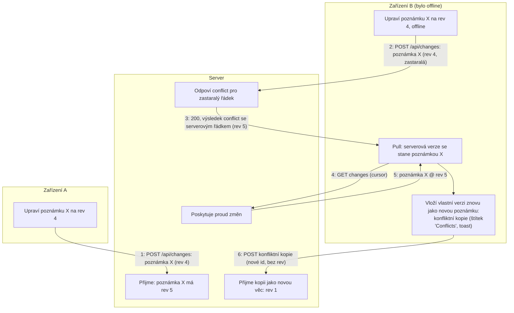

# Synchronizace

Jak funguje synchronizace, tak jak byla navržena v M5 a postavena.
Rozhodnuto 2026-08-12; model konfliktů je [ADR 0017](../adr/0017-note-level-last-writer-wins-with-conflicted-copies.md), rámec nasazení a autentizace je [ADR 0018](../adr/0018-the-server-serves-the-pwa.md) ([05-server.md](./05-server.md)).
Pojmy ze slovníku (revize, konfliktní kopie, tombstone (záznam o smazání), fronta offline změn) jsou kanonicky definované v [`CONTEXT.md`](https://github.com/soukupj00/your-notes-fe/blob/main/CONTEXT.md).

## Problém

Dvě zařízení mohou upravovat stejnou poznámku, zatímco jedno z nich je offline.
Skutečným předmětem sporu je tělo poznámky: je to jeden HTML řetězec a každý bohatší prvek (přílohy, seznamy úkolů) žije uvnitř něj.
Jakákoli strategie, která slučuje `header`, `color` a `state` pole po poli, se tak skutečného konfliktu vůbec nedotkla.

## Model: last-writer-wins na úrovni poznámky, poražené verze se ponechávají

**Server drží revizi pro každou synchronizovanou věc.
Push se zastaralou revizí je odmítnut; serverová verze se stane poznámkou a verze zařízení je ponechána vedle ní jako běžná poznámka - konfliktní kopie.**

Synchronizace nikdy nezahodí nic, co uživatel napsal.
Vyřešení konfliktu znamená, že člověk přečte dvě poznámky a jednu smaže - nikdy to není něco, co aplikace udělá potichu.
Konfliktní kopie je vystavená, ne skrytá: dostane štítek „Conflicts“ a hlavičku s názvem zařízení a datem, odkud pochází, takže stávající obrazovka `/tag/$id` slouží bez dalších nákladů jako místo pro kontrolu.
Upřímná cena modelu: souběžné úpravy jedné poznámky neztratí žádný text, ale vytvoří duplikát - způsob selhání, kterému uživatel rozumí a který dokáže napravit.

### Hranice revizí

| Synchronizovaná věc | Vlastní revize? | Proč |
|---|---|---|
| Poznámka (včetně *metadat* jejích příloh) | Ano | Agregát; příloha patří právě jedné poznámce a nemá nezávislý život |
| Štítek | Ano | Z definice nezávislý život |
| Vazba NoteTag | Ano | Záměrně zaplacená granularita: psaní do poznámky na notebooku a současné ťuknutí na „+ Štítek“ na telefonu nesmí vytvořit duplicitní kartu - označování štítkem nesmí nikdy kolidovat s psaním |
| Bajty přílohy | Ne | Zapisují se jednou podle id (jediný přepisovač, uložení Excalidraw, vytvoří nové id), takže přenos je idempotentní `PUT`, pro který žádné pravidlo konfliktu ani není možné |

### Mazání: tombstones

Přesun do koše je aktualizace pole `state` ([ADR 0009](../adr/0009-note-lifecycle-model.md)) a synchronizuje se jako běžná úprava, včetně okna pro vrácení zpět.
Tombstone (záznam o smazání) zapisuje jen trvalé smazání, takže skutečná smazání jsou vzácná a většinou je generuje stroj.
Tombstone nese `rev`, se kterým se zařízení naposledy shodovalo, a na zastaralé trvalé smazání server odpoví `conflict`, takže trvalé smazání nikdy nezahodí novější úpravu.
Tombstones na serveru vyprší po 90 dnech; zařízení, jehož kurzor je starší než toto okno, se to dozví a provede úplnou resynchronizaci - zahodí své čisté řádky a ponechá si ty změněné.
Na kurzor starší než okno tombstones nebo novější než pořadové číslo (Sequence) serveru (po obnovení) server odpoví `410` a zařízení se resynchronizuje od 0.

## Fronta offline změn je množina, ne log

Server má dostat *aktuální stav* každé změněné věci, ne historii, jak k němu došlo: deset offline úprav jedné poznámky znamená jeden push.
Z toho plyne implementace: každá změna označí svůj řádek jako změněný uvnitř transakce, která ho beztak zapisuje, a „fronta“ je množina změněných řádků - způsob čtení dat, ne druhé úložiště, které by s nimi mohlo být v rozporu.
To nahradilo dřívější plán uspořádaného logu záměrů, který byl pracnější i méně robustní (pád může zanechat log v rozporu s řádky).

## Smyčka

Klientský synchronizační engine běží v `SyncProvider` na hlavním vlákně, čte a zapisuje `LocalStore` a komunikuje s `Remote` ([ADR 0020](../adr/0020-the-local-store-seam.md)); Dexie se nikdy nedotýká (strop: přesun do Workeru, pokud by velký první pull zasekával UI).
`Remote` nese jen replikaci (push, pull, put/get blobu); relace, zařízení a pozvánky jsou samostatná, volitelná `AccountService`, kterou implementuje jen vlastní server, takže kdo si server hostuje sám, může synchronizaci nasměrovat na vlastní vzdálené úložiště.
Živá aktualizace je proud signálů přes SSE: server při každém přijatém push zapíše *pořadové číslo* změn daného účtu jako `id` události, zařízení na signál odpoví stejným `pull(cursor)`, jakým by se dotazovalo, a `Last-Event-ID` zajistí, že opětovné připojení zdarma naváže od pořadového čísla (přehodnoceno 2026-08-30, viz níže).
Dohnání změn spouští focus / `online` / viditelnost a pomalé dotazování je záloha, dokud je proud nedostupný; `Remote` bez proudu signálů se jednoduše dotazuje.

Strana pull: proud změn (change feed) je kolekce HAL; zařízení si jako kurzor ukládá neprůhlednou URL `_links.next` a nikdy si samo nesestavuje query string.
Po dohnání žádné `next` není, takže si ponechá `_links.resume`, které server nasměruje na aktuální pořadové číslo účtu; `next` navíc nese, kde pull začal (`from`), takže úplná resynchronizace může stránkovat i přes tombstones, které server už uklidil.
Stránky nesou silný `ETag` nad svým tělem a server odpovídá `304`, takže revalidace je levná.
Stránka ale není neměnná: znovu upravený řádek se přesune na nové pořadové číslo.
Synchronizační engine (`src/sync/engine.ts`) vlastní řešení konfliktů, komponenty nikdy; konfliktní kopie se zapisuje přes lokální úložiště jako každá jiná poznámka a její přílohy se naklonují pod novými id, aby každý blob měl jediného vlastníka.
Štítek konfliktní kopii nemá: vyhrává serverový štítek, protože dva štítky stejného jména by nikomu nepomohly.
Na zastaralé trvalé smazání server také odpoví `conflict` a zařízení si novější poznámku vezme zpět, místo aby ji smazalo.
V opačném případě - toto zařízení upravilo poznámku, kterou jiné zařízení trvale smazalo - se úprava rovněž ponechá jako konfliktní kopie, ať už push odpoví `gone`, nebo tombstone dorazí v pull.

## Přenos příloh

- Bajty jsou podle id neměnné, takže nahrání je „PUT, pokud server toto id nemá“ - idempotentní, opakovatelné, bez pravidla konfliktu.
- **Náhledy se synchronizují hned** (desítky KB; přehled je na novém zařízení okamžitě správný); **plné bajty na vyžádání**, s předvolbou „Uchovávat všechny přílohy“.
- Pohledy uzlů příloh mají třetí stav, „známá, ale nestažená“, ve kterém vykreslí zástupný prvek místo rozbitého prvku.
- Náhled je samostatný blob pojmenovaný podle `thumbnailId` přílohy na poznámce, takže se synchronizuje před plnými bajty.
  Zařízení si pamatuje, která id blobů server má, místo aby se ptalo pomocí `HEAD`; ztracený záznam stojí jeden opakovaný `PUT`, na který server odpoví 204, aniž by četl tělo.
  Nahrávání běží po pull v rámci daného běhu, náhledy před plnými bajty, a jen pro poznámky, které server zná.
  `413` se zaznamená na řádku a nahlásí jednou; nic ho neopakuje.
  Stahování, které zatím nic nenajde (druhé zařízení nahrává až po svém push, takže jeho signál může dorazit dřív), nechá běžet back-off smyčky.
  Obrázek příliš malý na to, aby dostal miniaturu, je sám sobě náhledem a stahuje se spolu s miniaturami.
- Známé stropy, přijaté: žádné obnovitelné nahrávání, žádná kvóta na účet.

## Interakce na hranici účtu

- **Převzetí při prvním přihlášení**: databáze, která ještě nebyla připojena, hromadně označí všechny řádky jako změněné a odešle je (UUID nemohou kolidovat).
- **Vymazání při odhlášení**: úplné lokální vymazání (server drží vše; brání tomu, aby další uživatel sdíleného notebooku převzal cizí poznámky), blokované, dokud je cokoli změněné, a s nabídkou zálohy do zipu předem.
- „Uloženo“ v editoru znamená *uloženo lokálně*; stav synchronizace se zobrazuje zvlášť, jako jeden počet čekajících změn v Nastavení, takže záruka local-first se nikdy nesměšuje se synchronizací.

## Přehodnoceno 2026-08-30

Návrh byl od nuly znovu posouzen proti širší sadě kandidátů - sedmi transportům a osmi návrhům na straně serveru včetně CouchDB + PouchDB, RxDB, Yjs + Hocuspocus, PocketBase, Zero, ElectricSQL a PowerSync - s explicitními vstupními podmínkami a váženými kritérii.
Pracovní poznámky: [`docs/sync-evaluation.md`](https://github.com/soukupj00/your-notes-fe/blob/main/docs/sync-evaluation.md); text práce: `ni-dip-thesys/text/design/sync.tex`; zdrojované poznatky jsou uložené u materiálů k diplomové práci, mimo tento repozitář.
Výše popsaný model vyhrál (148 ze 165; druhé RxDB se 117) a obstojí i po úplném odebrání kritéria „soulad se stávajícím frontendem“.
Vzešlo z toho pět úprav:

1. SSE je součástí návrhu, ne pozdějším doplňkem (viz výše).
2. Zastaralý push se hlásí po řádcích: `POST /api/changes` vrací uvnitř `200` jeden výsledek na řádek, `conflict` se serverovým řádkem, `gone` pro id s tombstone.
   `PUT` po jednotlivých zdrojích s `If-Match` je pozdější práce.
3. Proud změn má pořadové číslo na účet, odlišné od revizí jednotlivých řádků; kurzor `_links.next` i id události SSE jsou toto pořadové číslo.
4. Background Sync API je vylepšení jen pro Chromium (Safari ho nepodporuje vůbec); zárukou všude je množina změněných řádků opakovaně odesílaná při `online` a při otevření. Web Push je zamítnut z důvodu soukromí (relay třetí strany).
5. Id zůstávají náhodná UUID; UUIDv7 bylo zváženo kvůli lokalitě indexu a nebylo přijato.

## Zamítnuté alternativy (materiál pro práci)

- **Slučování po polích**: vyřeší levná pole a tělo poznámky - skutečnou kolizi - stejně ponechá na LWW; časová razítka po polích na každém řádku jsou za to špatný obchod.
- **Hotové synchronizační stacky** (2026-08-30): CouchDB vyhrává jen ve vyspělosti dohnání změn a nemá odvolání relace po zařízeních; Yjs vyhrává jen v kvalitě slučování a z HTML těla poznámky dělá odvozenou cache; PocketBase se vlastnímu řešení vyrovná v provozu a nemá revize, proud změn ani tombstones; enginy nad Postgresem jsou dvě až čtyři služby a zápisy nechávají na nás; Dexie Cloud a Couchbase neprojdou podmínkou open source. Podrobnosti v [`docs/sync-evaluation.md`](https://github.com/soukupj00/your-notes-fe/blob/main/docs/sync-evaluation.md).
- **CRDT (Yjs) pro tělo poznámky**: technicky lepší slučování, zamítnuté se zaznamenanými důvody. Ze Yjs dokumentu by udělalo skutečnou poznámku a z HTML odvozenou cache (což by porušilo invariant, na který spoléhají náhledy karet, vyhledávání, záloha a odkazy na přílohy), vyžaduje WebSocket místo závazku zadání k REST a bylo by největší jednotlivou položkou v M5, která by konkurovala skutečnému cíli milníku (synchronizace, kterou si nastaví průměrný člověk). Zůstává otevřené jako pozdější vylepšení jen pro tělo poznámky v rámci stejného rámce revizí.

## Strategie testování

Klientský engine se testuje v tomto repozitáři proti falešnému serveru postavenému z vendorovaného kontraktu Zod, takže cesty konfliktu, resynchronizace a offline jsou deterministické.
Backend se testuje sám ve svém repozitáři; skutečné end-to-end se dvěma zařízeními je manuální činnost a součást uživatelského testování (pipeline Playwright napříč repozitáři by stála víc, než kolik by odhalila).

## Pro text práce

- Návrh rámujte jako volbu *způsobu selhání*, ne algoritmu: LWW s konfliktními kopiemi vyměňuje automatické slučování za nulovou tichou ztrátu dat a nápravný krok, který zvládne i netechnický uživatel.
- Tabulka hranic revizí je hlavním analytickým přínosem: každý řádek je argumentem z návrhu agregátů.
- Oddíl o zamítnutém CRDT se sám nabízí do kapitoly o souvisejících pracích a alternativách; poctivý záznam toho, proč lepší slučování prohrálo, je přesně to, co text o architektuře potřebuje.
