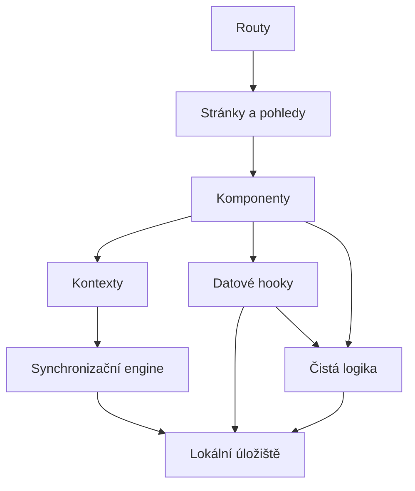

# Pro vývojáře

YourNotes je jednostránková aplikace v Reactu, která se instaluje jako PWA a vše uchovává v IndexedDB prohlížeče.
Je úplná i bez serveru; [server](https://soukupj00.github.io/your-notes-be/cs/developers/) žije ve vlastním repozitáři a přidává synchronizaci.
Pojmy používané zde, jako poznámka, štítek, příloha, lokální úložiště a vzdálené úložiště, definuje [`CONTEXT.md`](https://github.com/soukupj00/your-notes-fe/blob/main/CONTEXT.md).

## Vývoj

Potřebuje Node 24 a pnpm přes corepack (`corepack enable`).

```bash
pnpm install
pnpm dev          # http://localhost:5173
pnpm test         # Vitest
pnpm test:e2e     # Playwright; Testing covers the first run
pnpm check        # Biome: lint and format
pnpm lint         # ESLint: the React Hooks rules Biome cannot express
pnpm build        # type-check and build into dist/
pnpm docs:dev     # this site
```

Pro obrazovky účtu a synchronizace (Nastavení, `/pair`) spusťte vedle i `pnpm dev` serveru, z jeho repozitáře naklonovaného vedle tohoto.
Vite na něj přeposílá `/api` a `/health` na portu 3000.
Párovací odkaz, který server vypíše, míří na port 3000, takže jeho `/pair#<code>` otevřete místo toho na portu 5173.

Aby šla synchronizace vyzkoušet na skutečném telefonu, musí server tuto aplikaci servírovat přes `https`.
Návod serveru [Vyzkoušejte to na telefonu](https://soukupj00.github.io/your-notes-be/cs/developers/#vyzkouseni-na-telefonu) ukazuje jak, s `pnpm build` zde a Tailscale.

## Repozitář

| Cesta | Co tam je |
|---|---|
| `src/main.tsx` | Sestaví lokální úložiště a HTTP klienta, pak vykreslí aplikaci |
| `src/App.tsx` | Kořen kompozice: všechny providery kolem routeru |
| `src/routes/` | Routy založené na souborech; tenké, vyberou rozsah přehledu (feed) a titulek |
| `src/pages/`, `src/components/` | Pohledy, karta, editor, navigační kostra, Nastavení |
| `src/context/` | Providery pro celou aplikaci: motiv, předvolby, účet, synchronizace, průvodce |
| `src/hooks/data/` | Jediná cesta, jak komponenty čtou a zapisují poznámky, štítky a přílohy |
| `src/data/` | Rozhraní lokálního úložiště, jeho dvě implementace a HTTP klient serveru |
| `src/sync/` | Synchronizační engine a jeho smyčka, čistý TypeScript |
| `src/lib/` | Logika bez Reactu: vyhledávání, záloha, barvy, připomenutí, pravidla průvodce |
| `src/contract/` | Kontrakt komunikace se serverem, zkopírovaný ze serveru pomocí `pnpm contract:pull`; zde se nikdy needituje |
| `public/locales/` | Překlady, jedna složka na jazyk |
| `e2e/` | Testy v Playwrightu |

Závislosti míří jen dolů:



Stav má tři domovy, zvolené podle toho, jak dlouho žije.
Co uživatel právě prohlíží (vyhledávání, řazení, otevřená poznámka), je v URL.
Co uživatel vytvořil, je v lokálním úložišti.
Jen pomíjivé věci, jako zda je dialog otevřený, jsou stav Reactu.
[Architektura](../architecture/01-architecture.md) ukazuje celý obraz.

## Průvodci

- [Lokální úložiště](./local-store.md): rozhraní, přes které jde veškerá perzistence, a jak si přinést vlastní implementaci.
- [Synchronizace](./sync.md): revize, fronta offline změn, konfliktní kopie a rozhraní vzdáleného úložiště.
- [Editor](./editor.md): rozšíření TipTapu, lišta editoru a přidání nového druhu přílohy.
- [Jazyky](./i18n.md): překladové balíčky a přidání jazyka.
- [Design](./design.md): vizuální pravidla, která každá změna UI dodržuje.
- [Testování](./testing.md): co se testuje kde a co zůstává ruční.

Referenční kapitoly jdou hlouběji: [architektura](../architecture/01-architecture.md), [databáze](../architecture/03-database.md), [synchronizace](../architecture/04-sync.md), [server](../architecture/05-server.md), [technologie](../architecture/06-technology.md) a [testování](../architecture/08-testing.md).
Každé rozhodnutí a jeho důvody jsou v [záznamech o rozhodnutích](../adr/).

## Konvence

- Jen pnpm, nikdy npm ani yarn.
- Rozhraní a továrny na closures, nikdy třídy ([ADR 0022](../adr/0022-interfaces-and-closures-not-classes.md)).
- Id pochází jen z `mintId` a každý řádek vzniká přes továrnu v `src/lib/rows.ts`.
- Barvy se ukládají jako tokeny palety, nikdy jako surové hodnoty, aby jim motiv a paleta pro barvoslepé mohly přiřadit jiné hodnoty.
- Každý nový text vychází v angličtině i češtině.
- Soubory mají méně než 500 řádků; generované soubory (`src/routeTree.gen.ts`, `src/contract/index.ts`) se nikdy needitují.
- Testy přicházejí spolu se změnou; [Testování](./testing.md) říká, jaký druh.

## Release

Image serveru se staví z image tohoto repozitáře, proto se tento repozitář vydává jako první.

1. Zvyšte `version` v `package.json` a proveďte merge do `main`; CI publikuje image jako `latest`.
2. Označte ten commit tagem `v0.x.y` a pushněte tag; CI image sestaví, otestuje smoke testem a publikuje pod tímto tagem.
3. Vydejte server, jak popisují [jeho kroky releasu](https://soukupj00.github.io/your-notes-be/cs/developers/#release).
   Jeho image převezme to, co je v okamžiku buildu `latest` tohoto repozitáře, proto ho tagujte až po dokončení pipeline z kroku 1.

Tento web se sestavuje a publikuje na GitHub Pages při každém push do `main`.
