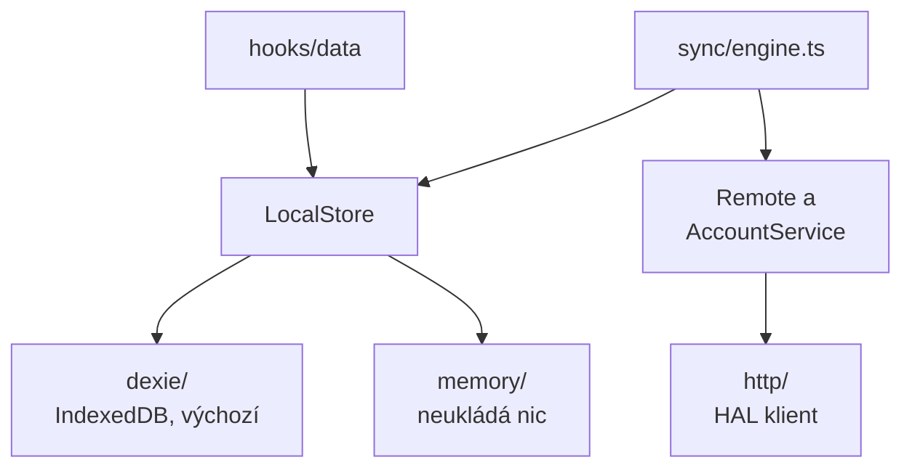

# Lokální úložiště

Lokální úložiště je kopie všeho, co aplikace v jednom zařízení drží, a jediná kopie, kterou aplikace přímo čte a zapisuje.
V kódu je to jedno rozhraní, `LocalStore` v `src/data/LocalStore.ts`, a každé čtení i zápis perzistentních dat jde přes něj ([ADR 0020](../adr/0020-the-local-store-seam.md)).



## Tvar rozhraní

Rozhraní mluví jazykem domény: o poznámkách, štítcích a přílohách, nikdy o tabulkách nebo transakcích.

- `notes`, `tags` a `attachments` obsahují čtení a zápisy pro jednotlivé druhy řádků.
  Každá metoda je sama o sobě atomická, takže volající nikdy neotevírá transakci.
- Čtení, které UI sleduje, vrací `Live<T>`, drobný observable s jedinou metodou, `subscribe`.
  Doručí aktuální hodnotu a pak každou hodnotu, kterou vyprodukuje pozdější zápis; React ji čte přes `useLive`.
- `meta` je malé úložiště klíč-hodnota pro evidenci kolem řádků: kurzor synchronizace, připojený účet.
  Předvolby tu nejsou; žijí v `localStorage`, protože patří zařízení.
- `sync` je to, co aplikace dluží serveru, a volá ho jen synchronizační engine.
- `exportAll` a `replaceAll` jsou to, co záloha čte a zapisuje.

Komponenty úložiště samy nikdy nevolají.
Jdou přes hooky v `src/hooks/data/`: `useNoteFeed` pro přehled (feed), `useNoteActions`, `useTagActions` a `useAttachmentActions` pro změny a `useTags`, `useTagsForNote` a `useNoteAttachments` pro živá čtení.
Vyhledávání, řazení a držené pořadí přehledu žijí v těchto hoocích, před úložištěm.

## Jeho pravidla

- **Úložiště nerazítkuje nic, co může orazítkovat volající.**
  Id pocházejí z `mintId` a obě časová razítka z továren řádků v `src/lib/rows.ts`.
- **Stav synchronizace je soukromou věcí úložiště.**
  Synchronizovaný řádek nese revizi, na které se naposledy shodl se serverem, a příznak změny (dirty), ale žádné čtení nevrací ani jedno.
  Žádný volající tak nemůže zanést zastaralou revizi do zápisu.
- **Každý zápis dluží serveru svůj řádek**; zápis přílohy dluží její poznámku, na jejíž revizi se metadata přílohy vezou.
- **Blob se pod daným id zapisuje jen jednou.**
  `attachments.update` nemůže převzít nové bajty; nové bajty jsou nová příloha.
- **Dexie zná jen `src/data`.**
  Biome odmítne import `dexie` kdekoli jinde a import `src/data/dexie/` mimo dvě místa skládání aplikace, `src/main.tsx` a `src/test/store.tsx`.

Úplný seznam i s důvody je v [`src/data/CLAUDE.md`](https://github.com/soukupj00/your-notes-fe/blob/main/src/data/CLAUDE.md).

## Dvě implementace

- **Dexie** (`src/data/dexie/`) je výchozí: IndexedDB s verzovaným schématem a migracemi.
  [Databáze a schéma](../architecture/03-database.md) popisuje její tabulky a historii jejích verzí.
- **Memory** (`src/data/memory/`) neukládá nic.
  Používá ji stránka odkazu pro sdílení, takže cizímu člověku, který otevře sdílenou poznámku, se do prohlížeče nic nezapíše.
  Zároveň dokazuje, že rozhraní není převlečené Dexie.

Obě procházejí stejnou sadou testů chování, `describeLocalStoreContract` v `src/data/localStore.contract.ts`.
Tato sada je specifikací: co ověřuje, to je lokální úložiště.

## Vlastní implementace

1. Implementujte `LocalStore` ve složce vedle `dexie/` a `memory/`.
2. Přidejte test, který proti ní spustí kontrakt, a zajistěte, aby prošel:

   ```ts
   import { describeLocalStoreContract } from '../localStore.contract.ts';
   import { createMyLocalStore } from './MyLocalStore.ts';

   describeLocalStoreContract(async () => createMyLocalStore());
   ```

3. V `src/main.tsx` změňte jediný řádek, který volá `createDexieLocalStore()`.

Přepínač za běhu neexistuje a existovat nebude: přepínač, kterým by uživatel mohl přejít na úložiště, které nic neukládá, je tlačítko na ztrátu dat.

Lokální úložiště je kopie v zařízení, takže musí být reaktivní, transakční a použitelné offline.
Úložiště jinde, například S3 bucket nebo váš vlastní server, je vzdálené úložiště (Remote), ne lokální úložiště; tento předěl popisuje stránka [Synchronizace](./sync.md).

## Změna schématu Dexie

Zvyšte verzi v `src/data/dexie/db.ts` a přidejte migraci, pokud ji existující řádky potřebují.
Past: IndexedDB vynechá z indexu řádek, jehož indexované pole je `undefined`.
Nové volitelné pole, které není indexované, je tedy zadarmo, ale nové indexované pole se musí doplnit do všech existujících řádků, jinak tyto řádky zmizí ze všech dotazů nad ním.
Migrace mají vlastní testy, každý nad jednorázovou databází.
