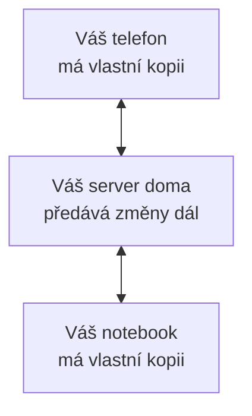

# Jak to funguje

YourNotes je aplikace, kterou otevřete ve webovém prohlížeči a pak nainstalujete, takže dostane vlastní ikonu a okno jako každá jiná aplikace.
Tato stránka vysvětluje, kde jsou vaše poznámky uložené, co přidává server a co se stane, když se něco pokazí.
Poznámka je jedna věc, kterou v aplikaci napíšete: pár slov, seznam úkolů, kresba, fotka nebo nahrávka.

## Vaše poznámky žijí na vašem zařízení

Zařízení je jeden telefon, tablet nebo počítač s nainstalovanou aplikací.
Vše, co napíšete, se nejdřív uloží na tomto zařízení, do vlastního úložiště prohlížeče.
Aplikace proto funguje úplně bez připojení k internetu a je úplná i bez serveru.
Když editor ukáže „Uloženo“, znamená to uloženo na tomto zařízení.

Když poprvé uložíte poznámku, aplikace požádá prohlížeč, aby její úložiště zachoval, i když dochází místo.
V Nastavení, v části „Synchronizace a záloha“ (na zařízení bez účtu „Záloha a úložiště“), pod „Toto zařízení“, uvidíte, zda prohlížeč souhlasil.
Pokud ne, prohlížeč může na zaplněném telefonu úložiště aplikace vymazat, proto si udržujte zálohu (viz níže).

## Instalace

Aplikaci otevřete na určité adrese v prohlížeči a odtud ji nainstalujete.
[Získat aplikaci](./get-the-app.md) ukazuje postup pro iPhone, Android a počítače.
Nainstalovaná aplikace se otevírá ve vlastním okně a spustí se, i když jste offline.

## Co přidává server

Sama o sobě aplikace uchovává vaše poznámky na jednom zařízení.
Abyste měli stejné poznámky v telefonu i v notebooku, musí někdo ve vaší domácnosti provozovat server YourNotes doma.
Web serveru má [návod krok za krokem](https://soukupj00.github.io/your-notes-be/cs/setup), jak ho nastavit, psaný pro lidi, kteří nejsou programátoři.

Se serverem:

- **Vaše zařízení zůstávají v souladu.** Změňte poznámku v telefonu a za pár sekund se objeví v notebooku.
- **Každý má vlastní účet.** Člověk, který server nastavil, tedy vlastník, může pozvat další členy domácnosti. Nikdo nevidí poznámky nikoho jiného.
- **Přihlášení je QR kód.** Přihlášené zařízení ukáže párovací odkaz jako QR kód a nové zařízení ho naskenuje. Na telefonu se nezadává žádné heslo.
- **Jednu poznámku můžete sdílet ke čtení.** Odkaz pro sdílení ukáže jedinou poznámku jako webovou stránku komukoli, kdo se dostane k vašemu serveru. Nemůže ji změnit a odkaz můžete kdykoli zrušit.
- **Ztracený telefon lze odhlásit** z kteréhokoli jiného zařízení, v Nastavení, v části Účet, pod Zařízení.

Na serveru své poznámky nečtete.
Každé zařízení má vlastní úplnou kopii a server mezi nimi jen předává změny.

## Synchronizace, a když jste offline

Synchronizace znamená odeslat vaše změny na server a stáhnout změny všech ostatních.
Probíhá sama: při otevření aplikace, když přestanete psát, když se obnoví připojení a každých pár minut.

Offline nic nepřestane fungovat.
Vaše změny čekají na zařízení a Nastavení ukazuje, kolik jich čeká.
Když se připojení vrátí, odejdou na server.

## Když se stejná poznámka změnila na dvou místech

Občas se stejná poznámka změní na dvou zařízeních dřív, než se stihla synchronizovat, třeba na telefonu bez signálu a na notebooku doma.
Aplikace nikdy žádnou z verzí nezahodí.
Verze, kterou server dostal jako první, zůstane poznámkou.
Druhá se stane novou poznámkou vedle ní, s názvem, který říká, odkud přišla, například „Groceries (conflict from Pixel 8, 2026-09-28)“, a se štítkem „Conflicts“.
Zpráva vám dá vědět, že se to stalo, s tlačítkem, které ji ukáže.

Abyste to vyřešili, přečtěte si obě, zkopírujte do jedné z nich, co chcete zachovat, a druhou smažte.

## Připomenutí

Poznámka může nést připomenutí, datum a čas, kdy se k ní chcete vrátit.
Aplikace v tu chvíli nezazvoní, protože webová aplikace nedokáže probudit telefon, když je zavřená.
Místo toho se připomenutí při nastavení předá do vašeho kalendáře jako událost: na telefonu přes nabídku sdílení, na počítači jako soubor, který otevřete.
Kalendář pak zazvoní jako u každé jiné události.

## Zálohy

V Nastavení, v části „Synchronizace a záloha“ (na zařízení bez účtu „Záloha a úložiště“), uloží „Exportovat zálohu“ soubor `.zip` se všemi poznámkami, štítky a přílohami.
Uchovávejte ho jinde než na zařízení, například na USB disku nebo ve složce, kterou už zálohujete.

„Obnovit zálohu“ vrátí soubor `.zip` zpět.
Nahradí vše, co je na zařízení uložené, proto vám nejdřív nabídne uložit zálohu současného stavu.
Vaše volby v Nastavení, jako motiv, jazyk nebo tlačítka editoru, patří k zařízení a v záloze nejsou.

Pokud provozujete server, umí vytvořit zálohu všech účtů najednou; [návod serveru](https://soukupj00.github.io/your-notes-be/cs/setup#8-zalohovani-a-obnova) ukazuje jak.

## Soukromí

- **Nic nejde nikomu dalšímu.** Aplikace neposílá žádný požadavek žádné firmě: žádné reklamy, žádná analytika, a dokonce i písma jsou její součástí.
- **Bez serveru** vaše poznámky nikdy neopustí zařízení.
- **Se serverem** jdou na váš server a na vaše další zařízení a nikam jinam.
- **Kdo provozuje server, může číst, co na něm je.** Poznámky nejsou na serveru šifrované, takže v domácnosti ho provozujte sami, nebo ho nechte provozovat někoho, komu důvěřujete.
- **Odhlášení vymaže kopii na zařízení.** Vaše poznámky zůstanou na serveru a vrátí se, až se znovu přihlásíte. Pokud některé změny ještě nedorazily na server, aplikace se zastaví a nabídne nejdřív synchronizovat nebo uložit zálohu.
