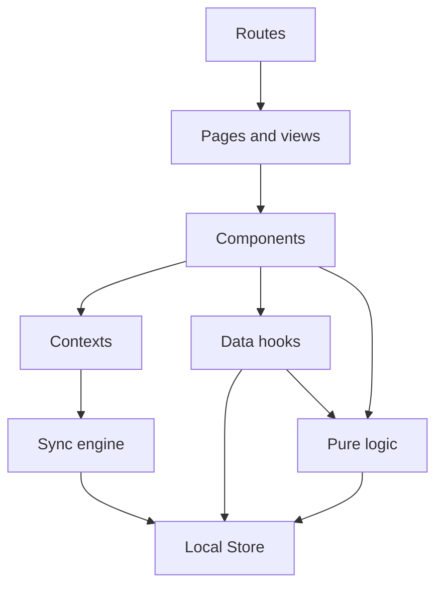

# For developers

YouNotes is a React single-page app that installs as a PWA and keeps everything in the browser's IndexedDB.
It is complete without a server; [the server](https://soukupj00.github.io/your-notes-be/developers/) lives in its own repository and adds sync.
The words used here, such as Note, Tag, Attachment, Local Store and Remote, are defined in [`CONTEXT.md`](https://github.com/soukupj00/your-notes-fe/blob/main/CONTEXT.md).

## Develop

Needs Node 24 and pnpm through corepack (`corepack enable`).

```bash
pnpm install
pnpm dev          # http://localhost:5173
pnpm test         # Vitest
pnpm test:e2e     # Playwright; Testing covers the first run
pnpm check        # Biome: lint and format
pnpm lint         # ESLint: the React Hooks rules Biome cannot express
pnpm build        # type-check and build into dist/
pnpm docs:dev     # this site
```

For the Account and sync screens (Settings, `/pair`), run the server's `pnpm dev` alongside, from its repository checked out next to this one.
Vite forwards `/api` and `/health` to it on port 3000.
The Pairing Link the server prints points at port 3000, so open its `/pair#<code>` on port 5173 instead.

To try sync on a real phone, the server has to serve this app over `https`.
The server's guide [Try it on your phone](https://soukupj00.github.io/your-notes-be/developers/#try-it-on-your-phone) shows how, with `pnpm build` here and Tailscale.

## The repository

| Path | What is there |
|---|---|
| `src/main.tsx` | Builds the Local Store and the HTTP client, then renders the app |
| `src/App.tsx` | The composition root: every provider, around the router |
| `src/routes/` | File-based routes; thin, they pick a Feed scope and a title |
| `src/pages/`, `src/components/` | The views, the Card, the editor, the nav shell, Settings |
| `src/context/` | The app-wide providers: theme, Preferences, Account, sync, the Tour |
| `src/hooks/data/` | The only way components read and write Notes, Tags and Attachments |
| `src/data/` | The Local Store interface, its two implementations, and the HTTP client of the server |
| `src/sync/` | The sync engine and its loop, plain TypeScript |
| `src/lib/` | Logic with no React: search, backup, colours, reminders, the Tour's rules |
| `src/contract/` | The wire contract, copied from the server by `pnpm contract:pull`; never edited here |
| `public/locales/` | The translations, one folder per language |
| `e2e/` | Playwright tests |

Dependencies point downward only:



State has three homes, chosen by how long it lives.
What the user is looking at (search, sort, the open Note) is in the URL.
What the user made is in the Local Store.
Only the ephemeral, such as a dialog's open state, is React state.
[Architecture](../architecture/01-architecture.md) has the full picture.

## Guides

- [The Local Store](./local-store.md): the seam all persistence goes through, and bringing your own.
- [Sync](./sync.md): Revisions, the Offline Mutation Queue, Conflicted Copies, and the Remote seam.
- [The editor](./editor.md): TipTap extensions, the toolbar, and adding an Attachment kind.
- [Languages](./i18n.md): the translation bundles and adding a language.
- [Design](./design.md): the visual rules any UI change keeps.
- [Testing](./testing.md): what is tested where, and what stays manual.

The reference chapters go deeper: [architecture](../architecture/01-architecture.md), [database](../architecture/03-database.md), [sync](../architecture/04-sync.md), [the server](../architecture/05-server.md), [technology](../architecture/06-technology.md) and [testing](../architecture/08-testing.md).
Every decision and its reasons is in the [decision records](../adr/).

## Conventions

- pnpm only, never npm or yarn.
- Interfaces and closure factories, never classes ([ADR 0022](../adr/0022-interfaces-and-closures-not-classes.md)).
- Ids come only from `mintId`, and every row is born through a factory in `src/lib/rows.ts`.
- Colours are stored as palette tokens, never raw values, so the theme and the colour-blind palette can re-value them.
- Every new string ships in English and Czech.
- Files stay under 500 lines; generated files (`src/routeTree.gen.ts`, `src/contract/index.ts`) are never edited.
- Tests land with the change; [Testing](./testing.md) says which kind.

## Release

The server's image is built from this repository's image, so this repository is released first.

1. Bump `version` in `package.json` and merge to `main`; CI publishes the image as `latest`.
2. Tag that commit `v0.x.y` and push the tag; CI builds, smoke-tests and publishes the image under that tag.
3. Release the server, as [its release steps](https://soukupj00.github.io/your-notes-be/developers/#release) describe.
   Its image takes whatever this repository's `latest` is when it builds, so tag it only after step 1's pipeline has finished.

This site is built and published to GitHub Pages on every push to `main`.
