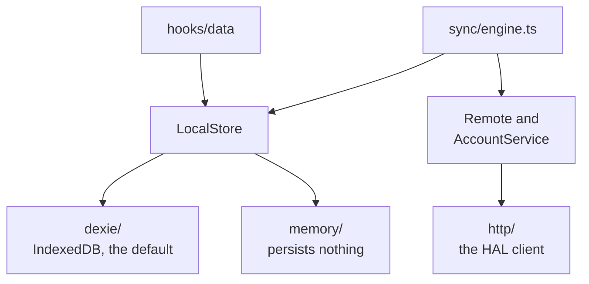

# The Local Store

The Local Store is the copy of everything the app holds on one Device, and the only copy the app reads or writes directly.
In code it is one interface, `LocalStore` in `src/data/LocalStore.ts`, and every read and write of persisted data goes through it ([ADR 0020](../adr/0020-the-local-store-seam.md)).



## The shape of the interface

It is domain-shaped: it speaks of Notes, Tags and Attachments, never of tables or transactions.

- `notes`, `tags` and `attachments` hold the reads and writes of each kind of row.
  Each method is atomic on its own, so a caller never opens a transaction.
- A read that the UI watches returns a `Live<T>`, a tiny observable with one method, `subscribe`.
  It delivers the present value, then every value a later write produces; React reads it through `useLive`.
- `meta` is a small key-value store for bookkeeping about rows: the sync cursor, the attached Account.
  Preferences are not here; they live in `localStorage`, because they belong to the Device.
- `sync` is what the server is owed, and only the sync engine calls it.
- `exportAll` and `replaceAll` are what a Backup reads and writes.

Components never call the store themselves.
They go through the hooks in `src/hooks/data/`: `useNoteFeed` for the Feed, `useNoteActions`, `useTagActions` and `useAttachmentActions` for changes, and `useTags`, `useTagsForNote` and `useNoteAttachments` for live reads.
Search, sort and the held Rank of a Feed live in those hooks, in front of the store.

## Its rules

- **The store stamps nothing a caller could stamp.**
  Ids come from `mintId` and both timestamps from the row factories in `src/lib/rows.ts`.
- **Sync state is private to the store.**
  A synced row carries the Revision it last agreed with and a dirty marker, but no read returns either.
  So no caller can carry a stale Revision into a write.
- **Every write owes its row** to the server; an Attachment write owes its Note, whose Revision its metadata rides on.
- **A blob is write-once by id.**
  `attachments.update` cannot take new bytes; new bytes are a new Attachment.
- **Only `src/data` knows Dexie.**
  Biome refuses an import of `dexie` anywhere else, and of `src/data/dexie/` outside the two composition points, `src/main.tsx` and `src/test/store.tsx`.

The full list, with the reasons, is in [`src/data/CLAUDE.md`](https://github.com/soukupj00/your-notes-fe/blob/main/src/data/CLAUDE.md).

## The two implementations

- **Dexie** (`src/data/dexie/`) is the default: IndexedDB, with a versioned schema and migrations.
  [Database and schema](../architecture/03-database.md) describes its tables and the history of its versions.
- **Memory** (`src/data/memory/`) persists nothing.
  The Share Link page uses it, so a stranger opening a shared Note gets nothing written to their browser.
  It is also what proves the interface is not Dexie in disguise.

Both run the same behaviour suite, `describeLocalStoreContract` in `src/data/localStore.contract.ts`.
That suite is the specification: what it checks is what a Local Store is.

## Bringing your own

1. Implement `LocalStore` in a folder beside `dexie/` and `memory/`.
2. Add a test that runs the contract against it, and make it pass:

   ```ts
   import { describeLocalStoreContract } from '../localStore.contract.ts';
   import { createMyLocalStore } from './MyLocalStore.ts';

   describeLocalStoreContract(async () => createMyLocalStore());
   ```

3. In `src/main.tsx`, change the one line that calls `createDexieLocalStore()`.

There is no runtime switch, and there will not be one: a toggle a user could flip to a store that persists nothing is a data-loss button.

A Local Store is the copy on the Device, so it has to be reactive, transactional and usable offline.
A store somewhere else, such as an S3 bucket or a server of your own, is a Remote, not a Local Store; [Sync](./sync.md) covers that seam.

## Changing the Dexie schema

Bump the version in `src/data/dexie/db.ts` and add a migration when existing rows need one.
The trap: IndexedDB leaves a row out of an index whose field is `undefined`.
So a new optional field that is not indexed is free, but a new indexed field must be backfilled on every existing row, or those rows vanish from every query on it.
Migrations have their own tests, each on a throwaway database.
