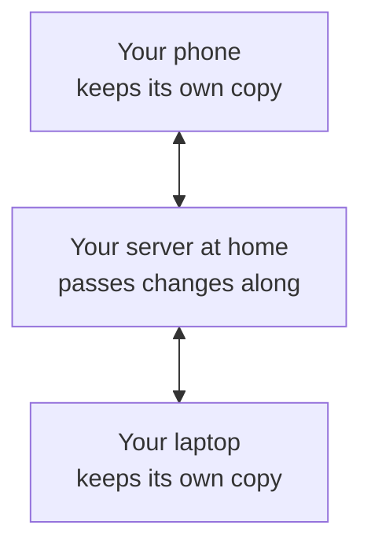

# How it works

YourNotes is an app you open in a web browser and then install, so it gets its own icon and window like any other app.
This page explains where your Notes are kept, what the server adds, and what happens when something goes wrong.
A Note is one thing you write in the app: a few words, a checklist, a drawing, a photo or a recording.

## Your Notes live on your Device

A Device is one phone, tablet or computer with the app installed.
Everything you write is saved on that Device first, inside the browser's own storage.
So the app works with no internet connection at all, and it is complete without a server.
When the editor says "Saved", it means saved on this Device.

The first time you save a Note, the app asks the browser to keep its storage even when space runs low.
Settings shows whether the browser agreed, under "This device" in "Sync and backup" ("Backup and storage" on a Device with no account).
If it did not, the browser may clear the app's storage on a full phone, so keep a backup (see below).

## Installing it

You open the app at an address in your browser, and from there you install it.
[Get the app](./get-the-app.md) shows the steps for iPhone, Android and computers.
Installed, it opens in its own window and starts even when you are offline.

## What the server adds

On its own, the app keeps your Notes on one Device.
To have the same Notes on your phone and your laptop, someone in your household runs the YourNotes server at home.
The server's site has [a step-by-step guide](https://soukupj00.github.io/your-notes-be/setup) for setting it up, written for people who are not programmers.

With a server:

- **Your Devices stay in step.** Change a Note on your phone and it shows up on your laptop a few seconds later.
- **Each person has their own Account.** The person who set up the server, the Owner, can invite others in the household. Nobody sees anyone else's Notes.
- **Signing in is a QR code.** A signed-in Device shows a Pairing Link as a QR code, and the new Device scans it. No password is typed on a phone.
- **You can share one Note to read.** A Share Link shows a single Note as a web page to anyone who can reach your server. They cannot change it, and you can end the link at any time.
- **A lost phone can be signed out** from any other Device, in Settings, under Account, then Devices.

The server is not where you read your Notes.
Each Device keeps its own full copy, and the server only passes changes between them.

## Syncing, and when you are offline

Syncing means sending your changes to the server and fetching everyone else's.
It happens on its own: when the app opens, when you stop typing, when the connection comes back, and every few minutes.

Offline, nothing stops working.
Your changes wait on the Device, and Settings shows how many are waiting.
When the connection returns, they go to the server.

## When the same Note changed in two places

Sometimes the same Note is changed on two Devices before they could sync, for example on a phone without signal and on the laptop at home.
The app never throws either version away.
The version the server got first stays the Note.
The other one becomes a second Note next to it, titled with where it came from, for example "Groceries (conflict from Pixel 8, 2026-09-28)", and labelled "Conflicts".
A message tells you it happened, with a button to show it.

To sort it out, read both, copy anything you want to keep into one of them, and delete the other.

## Reminders

A Note can carry a Reminder, a date and time you want to be brought back to it.
The app does not ring at that time, because a web app cannot wake your phone while it is closed.
Instead, setting a Reminder hands it to your calendar as an event: on a phone through the share menu, on a computer as a file you open.
Your calendar then rings as it does for any other event.

## Backups

In Settings, "Sync and backup" ("Backup and storage" on a Device with no account) has "Export a backup", which saves a `.zip` file with every Note, label and attachment.
Keep it somewhere other than the Device, for example on a USB stick or in a folder you already back up.

"Restore a backup" puts a `.zip` back.
It replaces everything stored on the Device, so it first offers to save a backup of what is there now.
Your choices in Settings, such as the theme, the language and the editor's buttons, belong to the Device and are not in a backup.

If you run a server, it can make a backup of every Account at once; [the server's guide](https://soukupj00.github.io/your-notes-be/setup#8-back-up-and-restore) shows how.

## Privacy

- **Nothing goes to anyone else.** The app makes no request to any company: no ads, no analytics, and even its fonts ship inside it.
- **Without a server,** your Notes never leave the Device.
- **With a server,** they go to your server and to your other Devices, and nowhere else.
- **The person who runs the server can read what is on it.** Notes are not encrypted on the server, so in a household, run it yourself or let someone you trust run it.
- **Signing out erases the Device's copy.** Your Notes stay on the server and come back when you sign in again. If some changes have not reached the server yet, the app stops and offers to sync first or save a backup.
