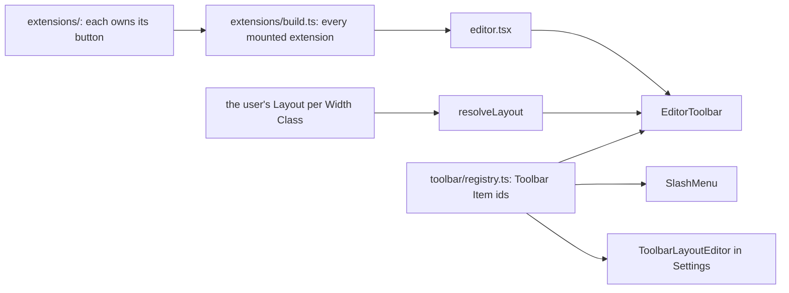

# CLAUDE.md - `src/components/editor` (TipTap editor)

How the rich-text editor is built.
The extension and toolbar pattern is fixed by [ADR 0004](../../../docs/adr/0004-canonical-editor-toolbar-pattern.md) and [ADR 0011](../../../docs/adr/0011-toolbar-items-and-families.md).



## Structure

- `editor.tsx` - the `Editor` component.
- `extensions/formatting.ts` - the one-button marks and blocks, as declarations.
- `extensions/<Name>/` - an extension with more than its declaration (a node view, a plugin, a coordinator), as `<Name>.ts` plus an `index.ts` re-export.
- `extensions/build.ts` - every extension the editor mounts, in one function, so the registry's tests resolve ids against the real set.
- `extensions/attachments/` - what the five attachment nodes share.
- `toolbar/` - the customisable toolbar.

### `editor.tsx`

**`content` is not a controlled value.**
It is read once, at creation, and every later change reaches the document through a `setContent` effect.
The editor is never recreated, and TipTap re-checks its options on every render: any option that fails reference equality costs a full ProseMirror view pass on top of the keystroke's own.
So the extensions array and `editorProps` are memoised and nothing in them may be reactive.
A live value reaches a built extension through `useLatest`, a stable getter over a ref, and a consumer must call `t()` lazily, never store its result at build time.
The "Editor content syncing" tests are the guard.

On mobile the note bar (labels, colour, pin, reminder) is handed in as `footer` instead of being rendered after the `Editor`, because a sticky element cannot leave its parent's box.
The note bar is in the flow, not pinned: the format toolbar is the only fixed chrome, since a second permanent strip costs the vertical space a phone has least of.

### `ActionButton`

The shared toolbar button (`src/components/ui/ActionButton.tsx`).
Three things to know before adding a button:

- **A menu row's name comes from context** (`MenuRowLabelProvider`), not a prop, because half the leaves are custom components that wrap an `ActionButton` and could never be handed a label.
- **The keyboard shortcut is desktop-only** and lives only in the tooltip, never on a menu row.
- **Active styling is a class**, not only `data-[state=on]`, because a popover trigger overwrites `data-state` with its own.

## Pattern A

The common case is the upstream TipTap extension plus a `button` option, built by `withButton`:

```ts
export const Bold = withButton(TiptapBold, ({ editor, t }) => ({
  component: ActionButton,
  componentProps: {
    action: () => editor.commands.toggleBold(),
    isActive: () => editor.isActive('bold'),
    icon: 'Bold',                       // string key into icons.ts
    shortcutKeys: ['Mod', 'B'],
    tooltip: t('editor.bold.tooltip'),
    toggle: true,
  },
}));
```

- An extension whose button is not an `ActionButton` (a colour picker, a font select, the link picker) calls `.extend()` itself and types its option `ButtonView<typeof ThatComponent>`.
- A `button` may return an array: Heading yields H1-H3, History yields undo and redo.
- `icon` is a string key into `src/components/icons/icons.ts`; never import a Lucide component into a button config.
- A new toolbar button is always an extension's `button`, never a toolbar-side list.

## The toolbar

A **Toolbar Item** has a stable id in `toolbar/registry.ts`, which maps it to its icon, name, family and the extension button it renders.
The same ids are the slash menu's, so the two surfaces cannot drift.
The registry also carries each Item's shortcut, a deliberate copy of the extension's own, so Settings can list shortcuts without a live editor; `shortcuts.test.ts` pins the copy in both directions.

Which Items show is user data: one **Layout** per **Width Class** (`compact`, `wide`), reconciled against the registry by `resolveLayout`.
`ToolbarLayoutEditor` edits a Layout and is mounted twice: in Settings, and in a sheet over the editor opened by the `⚙` Item.
The in-editor path must not navigate, because the dialog may hold an unsaved Draft.
Reordering is `@dnd-kit/sortable` through the shared `ui/SortableList.tsx`.

### The compact default

Compact is one non-wrapping row that scrolls sideways: it sits above the keyboard, so it may not take vertical space from the Note.
Wide wraps.

- The default is undo, redo and four collapsed families.
  Undo and redo are real buttons because a phone has no Ctrl+Z.
  Colour, block, align, font and the `⚙` are off, and stay reachable through the slash menu, a shortcut, or by switching them on.
- That is six slots, which is what fits a 360px phone (`COMPACT_FOLD_SLOTS` in `foldMarker.ts`).
  The sheet leaves 328px, and under the 44px Touch Rule with 4px gaps six buttons need 284px and a seventh 332px.
  It is a marker, not a limit: going past it is allowed, and Settings shows it so the user configures against the real constraint.
- A bar that fits spreads across its width (`justify-between`), which does nothing once it overflows.
- **The first family is pinned only while the row scrolls**, and that cannot oscillate: unpinning only makes the row narrower.
  This holds only because the pin's wrapper costs zero width.
  With any padding, a row that just fits would overflow once pinned, unpin, fit again, and so latch.

## Content styling

Content is styled by `@tailwindcss/typography` (`prose`), with three deliberate departures in `globals.css`:

- **Prose's palette is mapped to the theme tokens**, so the editor uses plain `prose`, not `dark:prose-invert`.
- **The plugin's vertical rhythm is replaced.**
  Typography is set for long articles and spent nearly half a Note's height on margins.
  One `--note-block-gap` separates every block, and type comes from the app's body tokens, so the same text is the same size in the editor and on its Card.
- **The rules are scoped to `.prose`, not `.tiptap`**, because a Note has two surfaces, the editor and the Card's preview of the same stored markup, and both must move together.

Checklist rows:

- A row is `flex`, to put the box beside its text.
  That defeats `-webkit-line-clamp`, which is why the Card caps a Checklist's height with `max-height` instead.
- On a coarse pointer the box's hit area is exactly its drawn size, DESIGN.md's one recorded exception to the Touch Rule.
  A larger invisible hit box reached into the text, so a tap on an item's first letters ticked it instead of placing the caret.
  Grow the visible box if mis-taps show up; never restore a hidden halo over the text.
- The reorder grip is drawn at the line's own height so it cannot set the row's height.
  It is always visible on a coarse pointer and appears on hover on a fine one.

## Checklist behaviour

Sinking ticked rows is a CSS `order` rule ([ADR 0013](../../../docs/adr/0013-checklist-sinking-is-presentation-not-storage.md)), so a ticked row is in its new slot by the time the browser paints.
`extensions/TaskList/ChecklistFlip.ts` adds only the travel between the two positions, and **moves nothing in the document**.
It is a plugin rather than an effect because it needs the old geometry just before the view writes the DOM and the new just after.
Do not reintroduce a document mutation here: the stored order is what a Backup and Sync carry, and it is the only record of the order the user typed.

`extensions/TaskItem/` adds the reorder grip in the editable node view only, driven by pointer events so a finger can use it; the stored Body and the Card never carry a grip.
Its `ignoreMutation` must keep treating the row's own attribute changes as non-edits, or a rebuilt node view drops the row from under the pointer mid-drag.

List buttons convert the whole list when the cursor is collapsed inside one (`extensions/list-toggle.ts`), because a task list uses a different item type from the other two.

## Attachments

All five kinds (image, audio, video, file, Excalidraw) are custom nodes from one factory, `createAttachmentNode`.

- **The Body stores only an `attachmentId`**, never a `src` or base64.
  The bytes live in the Local Store, and a node view resolves the id to an object URL and revokes it on unmount.
- **Each kind's facts are one row of `ATTACHMENT_SPECS`** (`src/lib/attachments.ts`): MIME prefix, whitelist, size cap, Body tag, picker `accept`.
- **`attachments/insert.ts` is the one path from files to nodes**, for paste, drop, the toolbar, the slash menu and the picker Starts: it validates, derives what the kind needs (a thumbnail, a poster, a duration), stores, and places the node.
  Every failure reaches one error callback, which the editor toasts.
- **File** is toolbar-only: it accepts any type, so paste and drop cannot tell it from the other kinds.
- `AttachmentNodeView` draws what the visual kinds share: the delete overlay, the loading pulse, and the missing and not-downloaded placeholders.
- **Known but not downloaded** is a row synced from another Device whose full bytes are still on the server.
  The node view reads the row live, so a download turns it ready without reopening the Note.
  An image shows its thumbnail with a download button; other kinds show a card.
  The Card on the feed never downloads.
- An image's and a video's pixel size is stored at insert, so the box is reserved before the bytes land.

### Audio

- A custom player over a hidden native `<audio>`; the element's own events are the source of truth for playback state.
- **The recorder lives in `AudioRecorderHost`**, which the editor mounts whenever it is editable, not in the toolbar button.
  On a phone the button sits inside a collapsed menu, so a recorder living there was not mounted when a voice note started from the speed dial.
  The button is only a request into the coordinator.
- `audioCapture.ts` and `audioAutoplay.ts` are pending-then-fire coordinators outside React, because the host, the Intent and the Note's content mount in no fixed order.
  The capture coordinator hands a request back if the recorder answering it unmounts first, which React StrictMode's mount cycle does in development.
- The recorder checks the microphone permission before asking for a stream, and treats only `denied` as final, because Firefox and Safari cannot answer the query.
- Uploading an audio file goes through the File button; the Audio button only records.

### Excalidraw

- The scene is a JSON blob with a cached SVG preview; the node view is a passive preview with tap-to-edit.
- One shared `ExcalidrawDialog`, lazy-loaded when a drawing first opens, holds the live canvas.
  `NotesView` lazy-loads the editor in the same way, so neither TipTap nor the drawing engine is in the initial download.
- **Commit on Save**: a new drawing creates its Attachment only on Save, and every Save mints a new Attachment and repoints the node, so every blob stays write-once by id for Sync.
  The orphan sweep removes the old one.
- **The dialog withholds pointer moves above the canvas** during a drag that started on it, with a capture-phase `window` listener.
  The canvas takes pointer capture, so without it a stroke kept extending under the header, hidden but still in the exported image.
- **The dialog's entrance does not scale**, and that is load-bearing.
  Excalidraw sizes its canvas from a rect that includes transforms, so opening mid-scale left every stroke off the cursor; the fade is kept.
- The SVG exporter imports Excalidraw dynamically, because importing it eagerly touches a canvas at module scope and crashes under jsdom.

## Text styling

Text colour, highlight, font family and font size ride on the one `textStyle` mark.
The two colour buttons share `EditorColorPickerButton`; the two font selects share `EditorTextStyleSelect`.

### Live color preview

In the custom colour picker a drag only previews the colour, as a ProseMirror decoration (`extensions/color-preview.ts`), and the mark is committed on release.
So a drag is one undo step, not one per mouse move.
The commit goes to the selection captured when the popover opened, without focusing the editor, which would close the popover.

## Other extensions

- **Mathematics** is the bundled TipTap extension: `$$...$$` inline, `$$$...$$$` block, or the toolbar button; clicking a rendered node edits it.
- **Typography** skips its rules inside a formula still being typed, before the closing `$$` makes it a math node, or `x^2` and `->` would be rewritten out of the LaTeX.
- **Clear** is not a mark: its button clears nodes and marks.
- **Intent**: the `Editor` takes the open's Intent (`src/lib/intent.ts`) and acts on it once: start recording, open the drawing, insert the chosen files, play the first clip.

## The editor sheet

`NoteEditorDialog` (`src/components/notes/`) is a full-screen sheet below `sm:` and a centred modal above it.

- Below `sm:` the sheet closes from an app-bar Back arrow and the dialog's X is hidden.
  The X is hidden by a **descendant** selector on its `data-slot`; a child selector silently matches nothing, because the close does not render as a direct child.
  For the same reason the Back arrow is a plain button, not a `DialogClose`, which would carry that `data-slot` and be hidden too.
- Below `sm:` the sheet has no bottom padding: the format toolbar owns the bottom edge and its insets, so it sits on the keyboard.
- Top and side padding are tighter than the dialog's default, with the safe-area insets added, so the Back arrow never sits under the status bar.

## Testing extensions

Tests run headless: build `new Editor({ extensions: [...] })` from `@tiptap/core`, drive `editor.commands.*`, and assert `editor.getHTML()` and `editor.isActive(...)`.
Pull a button from the extension's `button` option and assert its props and that `action()` flips `isActive()`.

`extensions/formatting.test.ts` is the template: one table, one row per extension, plus a case for anything only one of them does.
The attachment nodes are tested as tables too, in `extensions/attachments/`; a kind's own test keeps only what is its own.
