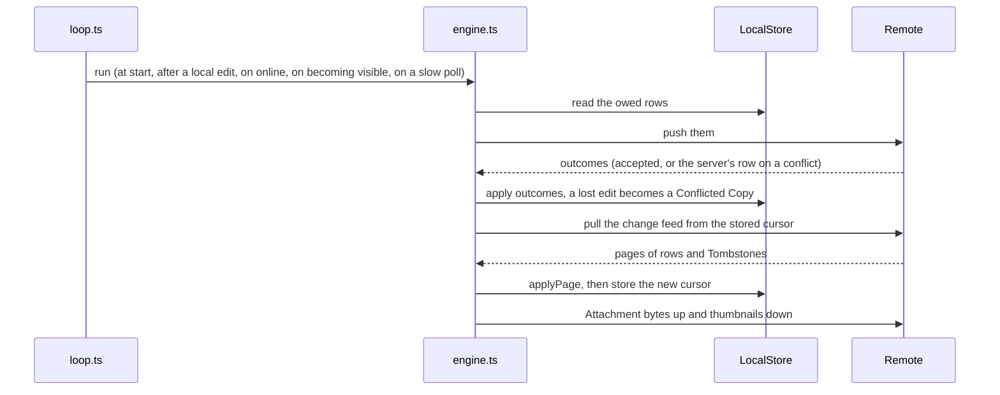

# CLAUDE.md - `src/context` (React providers)

App-wide providers.

## Where each one sits

`App.tsx` composes, outermost first: `LocalStoreProvider` (in `src/data`), `ThemeProvider`, the error boundary, `PreferencesProvider`, `AppMotionProvider`, `PwaInstallProvider`, `TooltipProvider`, `ViewModeProvider`, `AccountProvider`, then the router.
`routes/__root.tsx` adds `TourProvider` around `SyncProvider` around the nav shell, because both need the router:

- The Tour reads the location, marks the whole body inert and portals past the app, so it sits above the shell.
  The Welcome, beside the shell, does the same for launch.
- Sync shows toasts that link into the app, so it sits inside the router.

`/share/$token` gets neither (root `CLAUDE.md`, Routing).

Search text and the open Note are not here: they live in the URL (root `CLAUDE.md`, Data layer).

Which hooks throw outside their provider is deliberate.
`useLocalStore`, `usePreferences`, `useViewMode` and `useTour` throw, because a caller without them would silently do nothing.
`useAccount`, `useSync`, `useTourActive`, `usePwaInstall` and `useTheme` answer a neutral default ("no server", "not syncing", "no Tour", "cannot install", `system`), because their callers are components that tests mount alone.

## `AccountProvider.tsx`

Whether this Device is signed in to a Self-hosted Server ([ADR 0018](../../docs/adr/0018-the-server-serves-the-pwa.md)).

- It asks `AccountService.session()` once at startup.
  The session is an `HttpOnly` cookie, so there is nothing to read locally, and the server that served the app is the server, so there is no URL to configure.
- `status` is `checking`, `unavailable` (nothing answered: a static host, offline, no service), `signed-out` or `signed-in`.
  **Nothing in the app waits on it**: sync is opt-in, so every screen renders the same whatever it hears.
  Its readers are the account surfaces: the Account, Devices, Members and Shares sections of Settings, `/pair`, the Share and Pairing Link buttons, sign-out, and `SyncProvider`.
- `setSession` takes what a sign-in, pairing or sign-out just answered, so no second request is needed.
- When nothing answered, it asks again on `online` and when the page becomes visible, so the app starts syncing without a restart.
  A signed-in Device is not re-asked; if the server forgets its Session, `SyncProvider` sets it signed out.
- `main.tsx` builds one HAL client and hands it in as both `service` and `remote`.

## `SyncProvider.tsx`

Runs Sync while this Device is signed in ([04-sync.md](../../docs/architecture/04-sync.md)).
What happens in a run is `src/sync/engine.ts`; when a run happens is `src/sync/loop.ts`.
Both are plain TypeScript, tested against `src/test/fakeServer.ts`.

- On a session it first **adopts** (a new Account owes the whole library), then starts the loop; on sign-out or a change of Account it stops it.
- A `401` from a run (the Device was removed elsewhere) stops the loop and signs the Device out with one toast.
  Nothing is erased: owed rows wait for the next sign-in.
- **Attachment bytes** move at the end of each run (`src/sync/attachments.ts`): thumbnails up first, then blobs, every missing thumbnail down.
  Full bytes come down on a tap (`download(id)`), or after every run while the `keepEverything` Preference is on.
  A blob the server refuses for its size is one toast and is never retried.
- It exposes `{ active, status, lastSyncedAt, pending, syncNow, stop, download }`.
  `pending` is the store's live count of what the server is owed, so it is right signed out too.
  `stop()` waits for a run in flight, which is what makes erasing safe.
- Sign-out (`components/account/SignOutButton.tsx`) is refused while `pending > 0`, offering Sync now and a Backup; otherwise it ends the Session, stops the loop and clears the store.

## `PreferencesProvider.tsx`

User Preferences, one Zod-validated blob in `localStorage` ([ADR 0020](../../docs/adr/0020-the-local-store-seam.md)).

- `localStorage`, not the Local Store: Preferences are a Device fact that does not sync, and a synchronous read means the first render already has the user's density and motion choice.
- `preferencesSchema` owns the shape and every default, so a new Preference is a code-only change; the blob is versioned on its own.
- **Anything unreadable yields defaults**, and a failed read leaves the bad blob on disk, so a read can never destroy data.
- `setPreference(key, value)` reads, modifies and writes against `localStorage` itself, not React state.
- A `storage` event from another tab is the only other way `preferences` changes.

## `TourProvider.tsx`

The Settings Tour's lifecycle ([ADR 0024](../../docs/adr/0024-a-welcome-at-launch-the-tour-in-settings.md)); everything it decides is in [`src/lib/tour/`](../lib/tour/) and tested there.
The rules of the Tour are in the root `CLAUDE.md`, Onboarding.

- An effect offers the Tour once, on the first visit to Settings, when `onboardingSeenAt` is unset; `start` waits for the Settings page to paint.
- The Tour never navigates, so any change of location ends it.
- `driver.js` only measures a rect, cuts a hole and places a box; everything read or pressed is `components/tour/TourPopover.tsx`, portalled into it.
  Driver measures that box once, so the provider waits for the popover to render the step and for the fonts before handing it over.

## `themeProvider.tsx`

A custom theme provider (not `next-themes`).

- The theme is `dark`, `light` or `system`, persisted under its own `localStorage` key; `App.tsx` defaults to dark.
- On change it toggles the `light` or `dark` class on `<html>`, then writes the resolved `--background` into `<meta name="theme-color">`, which colours Android's status bar and a browser tab's toolbar.
  It is written from JS because the app's theme is an explicit choice that may disagree with the OS, which is all a media-query `<meta>` can follow.
  It is always the app's frame, never a Note's tint: a tint would have to be unset on every path out of the editor.
- The colour values are the OKLCH tokens in `src/styles/globals.css`.

## The small ones

- `viewModeProvider.tsx`: the Feed's layout, Masonry or Stack, kept under its own `localStorage` key.
- `motionProvider.tsx`: makes the reduced-motion Preference authoritative for the Motion library and lazy-loads its features.
  Presence animations still need an explicit zero duration, because Motion keeps opacity.
- `PwaInstallProvider.tsx`: captures Chromium's one-shot install prompt so Settings can offer Install later; `canInstall` is false where the browser has no such prompt or the app is already installed.
