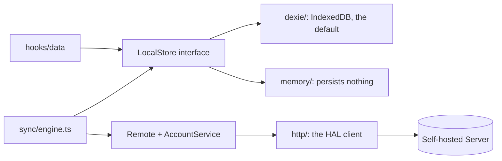

# CLAUDE.md - `src/data` (the Local Store)

The seam every read and write of persisted data goes through ([ADR 0020](../../docs/adr/0020-the-local-store-seam.md)).
Terms are in [CONTEXT.md](../../CONTEXT.md) (Local Store, Remote, Preference).

## Files

- `LocalStore.ts` - the interface: domain-shaped, atomic per method, live reads return `Live<T>`.
- `live.ts`, `useLive.ts` - the observable contract and its one React adapter.
- `LocalStoreProvider.tsx` - the context; `useLocalStore()` throws outside it.
- `localStore.contract.ts` - the behaviour every implementation must have.
  It is the spec, and both implementations run it, together with the sync and pull contracts beside it.
- `syncRows.ts` - pure helpers both implementations share for sync state.
- `dexie/` - the default implementation.
  `db.ts` is private to this folder.
- `memory/` - the second implementation: nothing persists, atomic by being single-threaded.
  It is the "cache only" configuration, and what proves the interface is not Dexie in disguise.
- `Remote.ts` - the sync seam: `Remote` (replication) and `AccountService` (Sessions, Devices, Pairing, Share Links), typed from the vendored contract in `src/contract/`.
- `http/` - the Self-hosted Server's implementations of both.
  `hal.ts` is the one door: it follows the HAL root's links, parses every body with the contract, so drift throws at the boundary, and turns a problem response into `ProblemError`.
  `publicShare.ts` is the one read without an Account: a Share Link's page.

## Rules

- Nothing outside `dexie/` imports `dexie`, and nothing outside `src/data` imports from `dexie/` except the two composition points, `main.tsx` and `src/test/store.tsx`.
  Biome enforces it.
- **The store stamps nothing a caller could stamp.**
  Ids and a row's birth timestamps are the caller's (`lib/rows.ts`).
  The exceptions are the store's own bookkeeping: `tags.merge` stamps the links it relabels, `tags.setPositions` stamps the labels it reorders in one write, and a Tombstone gets its `deletedAt`.
- Search, sort and held rank live in `src/hooks/data`, in front of the seam.
- `meta` is bookkeeping about rows: the sync cursor and the attached Account.
  Preferences are not here; they are in `localStorage`.
- The sync engine (`src/sync/`) is the only caller of `sync.*`.

### Sync state is store-private

- A synced row carries a `rev` (the Revision it last agreed with; absent means never pushed) and a dirty marker (owed to the server).
  Neither leaves the store on a read, and every write keeps the stored `rev`, so no caller can carry a stale Revision into a write.
- Every write owes its row.
  An Attachment write owes its Note, because an Attachment's metadata rides on the Note's Revision.
- Removing a row the server has seen leaves a Tombstone with its `rev`; one never pushed leaves nothing, and putting the row back takes the Tombstone back.
- `applyPage` writes what the server answers, in two modes.
  In `keep-local` (a pull) an owed row or a pending purge waits for its push; in `server-wins` (resolving a push outcome) the server's row overwrites it.
  A server Tombstone removes the row with everything that hangs off it, and writes no local Tombstone.
- A pulled Note's `attachments` become its Attachment rows: new ones arrive without bytes, known ones keep theirs, unlisted ones are removed.
- An Attachment's transfer state (which blob ids the server holds, whether it was refused as too large) is store-private too, so a clone never inherits "already uploaded".
- **A blob is write-once by id.**
  `attachments.update` cannot take a `blob`, and takes a thumbnail only with a new `thumbnailId`; downloaded bytes arrive through `sync.received`.
  `blob` is optional on a row: one pulled from another Device has metadata first and its full bytes only once someone asks.

## Bringing your own Local Store

1. Implement `LocalStore` in a folder beside `dexie/` and `memory/`.
2. Add a test file that calls `describeLocalStoreContract(() => makeYourStore())` and make it pass.
3. Change the one line in `src/main.tsx` that calls `createDexieLocalStore()`.

There is no runtime switch and there will not be one: a user-facing toggle to a non-persisting store is a data-loss button.

## Dexie implementation

There is no seeder, and a fresh install has no Notes.

### Schema

| Table         | Primary key         | Holds |
|---------------|---------------------|-------|
| `notes`       | `id`                | Notes, indexed by lifecycle `state`, the timestamps and the dirty marker |
| `attachments` | `id`                | every Attachment kind in one table, indexed by `noteId` and `kind` |
| `tags`        | `id`                | Tags |
| `noteTags`    | `[noteId+tagId]`    | the Note to Tag links |
| `settings`    | `key`               | the store's `meta` (the table kept its old name; no schema bump was spent on a rename) |
| `tombstones`  | `id`                | what a Purge owes the server |

- **Attachments** are one table with a `kind` discriminator, and their bytes are a native `Blob` ([ADR 0007](../../docs/adr/0007-blob-over-base64-for-attachment-payloads.md)).
  The Body references an Attachment by id and never embeds it.
- **Note lifecycle** ([ADR 0009](../../docs/adr/0009-note-lifecycle-model.md)): `state` is `active`, `archived` or `trashed`; `pinnedAt`, `color` (a palette token, never a raw colour) and `trashedAt` are separate optional fields.
- **An indexed field must never be `undefined`**: IndexedDB skips such rows, so they would be invisible to a query on that index.
  That is why the lifecycle migration backfills `state`, and why the dirty marker is `1` or absent.
- A schema change bumps the Dexie version and brings a migration if existing rows need one.
  Rows from before sync need none: an absent `rev` correctly means "never pushed", and the first sign-in adopts them.
